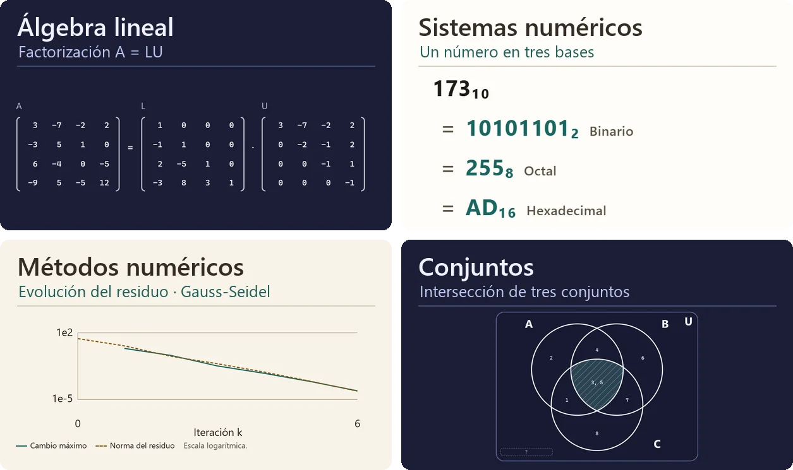
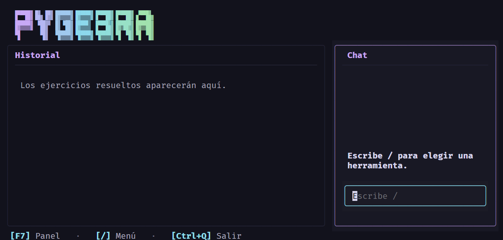

<h1 align="center">
  
</h1>

PyGebra es una **calculadora educativa** para resolver sistemas y matrices,
convertir números, explorar métodos numéricos y trabajar con conjuntos.
Muestra el resultado y los pasos para obtenerlo. Desarrollada por estudiantes
de Ingeniería en Sistemas.

[](https://github.com/Collado-Labs/Algebra-Lineal/actions/workflows/ci.yml?query=branch%3Adevelop)
[](https://github.com/Collado-Labs/Algebra-Lineal/releases/latest)
[](pyproject.toml)
[](docs/instalacion-windows.md)

**[Descargar para Windows](https://github.com/Collado-Labs/Algebra-Lineal/releases/latest)** ·
[Documentación](docs/README.md) · [Wiki](https://github.com/Collado-Labs/Algebra-Lineal/wiki) · [Desarrollo local](#desarrollo-rápido) ·
[Contribuir](CONTRIBUTING.md)

## Qué puedes resolver

De una matriz factorizada a una intersección de conjuntos, cada herramienta
muestra el cálculo en la forma que mejor ayuda a seguirlo.

<picture>
  <source media="(max-width: 700px)" srcset="docs/capturas/portada/modulos-movil.webp">
  
</picture>

- **[Álgebra lineal](docs/funcionalidades.md#operaciones-matriciales-y-ax--b).** Trabaja con matrices y vectores, reduce por filas, resuelve $Ax = b$ y comprueba inversas y determinantes.
- **[Sistemas numéricos](docs/funcionalidades.md#sistemas-numéricos).** Convierte entre binario, octal, decimal y hexadecimal, y entre números arábigos y romanos.
- **[Métodos numéricos](docs/sistemas-iterativos.md).** Explora métodos de raíces con gráficas y compara Jacobi y Gauss-Seidel con tablas e iteraciones.
- **[Conjuntos](docs/conjuntos.md).** Explora operaciones, intervalos y cardinalidad con diagramas de Venn editables.

## Cinco estilos de interfaz

**Estudio** acompaña el procedimiento paso a paso. **Minimalista** reduce la
interfaz a lo esencial. Los estilos homenaje **ChocoLab**, **BelugaCalc** y
**HeyAlgb** cambian la apariencia y la navegación. Los cinco tienen tema claro y
oscuro y se eligen en **Opciones → Apariencia**.

[](docs/temas-homenaje.md)

[Estudio y Minimalista en claro y oscuro](docs/capturas/temas-homenaje/estudio-minimalista-herramienta.png) ·
[Galería y créditos de los temas homenaje](docs/temas-homenaje.md)

## Consola interactiva

La consola interactiva se incorporó a PyGebra en v0.20.0. Abre el
catálogo con `/`, valida vectores y matrices mientras escribes, muestra
tablas y gráficas navegables y guarda los ejercicios en un historial local.
[Ejecuta la consola desde el código fuente](docs/ejecucion.md#aplicación-de-terminal).

[](docs/capturas/portada/consola-bienvenida.webp)

[Ver un ejemplo de bisección en la consola](docs/capturas/portada/consola-biseccion.webp).

## Formas de usar el proyecto

| Interfaz | Uso |
| --- | --- |
| Escritorio Windows | Herramientas visuales en una ventana local. |
| Django en desarrollo | La misma interfaz desde el navegador local. |
| Terminal | Álgebra lineal, sistemas numéricos, métodos numéricos y conjuntos desde el menú `/`. |

La interfaz visual incluye tema claro/oscuro, búsqueda de herramientas y
teclado matemático contextual.

## Instalación en Windows

Descarga **PyGebra-Setup-\<versión\>.exe** desde
[GitHub Releases](https://github.com/Collado-Labs/Algebra-Lineal/releases/latest) y
ejecuta el instalador. Abre **PyGebra** desde el menú Inicio. El instalador incluye
Python y las dependencias. La aplicación funciona sin conexión una vez instalada.

Requiere Windows 10 1809 o posterior, o Windows 11, con soporte para
aplicaciones x64. Si falta WebView2, su instalación requiere Internet.
El instalador no tiene firma digital.

[Requisitos e instalación](docs/instalacion-windows.md) ·
[Verificar la descarga con SHA-256](docs/releases.md#verificar-una-descarga)

## Desarrollo rápido

El motor matemático está en **Python**. **Django** sirve la interfaz y
**pywebview** la abre en Windows con **WebView2**. **PyInstaller** e **Inno Setup**
empaquetan la aplicación y **GitHub Actions** verifica y publica las versiones.

Con Git y [uv](https://docs.astral.sh/uv/) instalados:

```bash
git clone https://github.com/Collado-Labs/Algebra-Lineal.git
cd Algebra-Lineal
git switch develop
uv sync --locked
uv run --locked python manage.py runserver
```

Abre <http://127.0.0.1:8000/>. uv puede instalar la versión indicada en
`.python-version`.

[Ejecutar desde el código fuente](docs/ejecucion.md) ·
[Arquitectura](docs/arquitectura.md) · [Pruebas](docs/pruebas.md)

## Contribuir

Parte de **develop** y abre tu PR hacia esa rama. La
[guía de contribución](CONTRIBUTING.md) explica el flujo, las verificaciones y los
criterios que conservan los procedimientos matemáticos.
