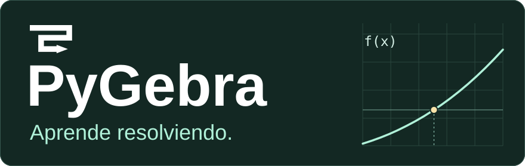
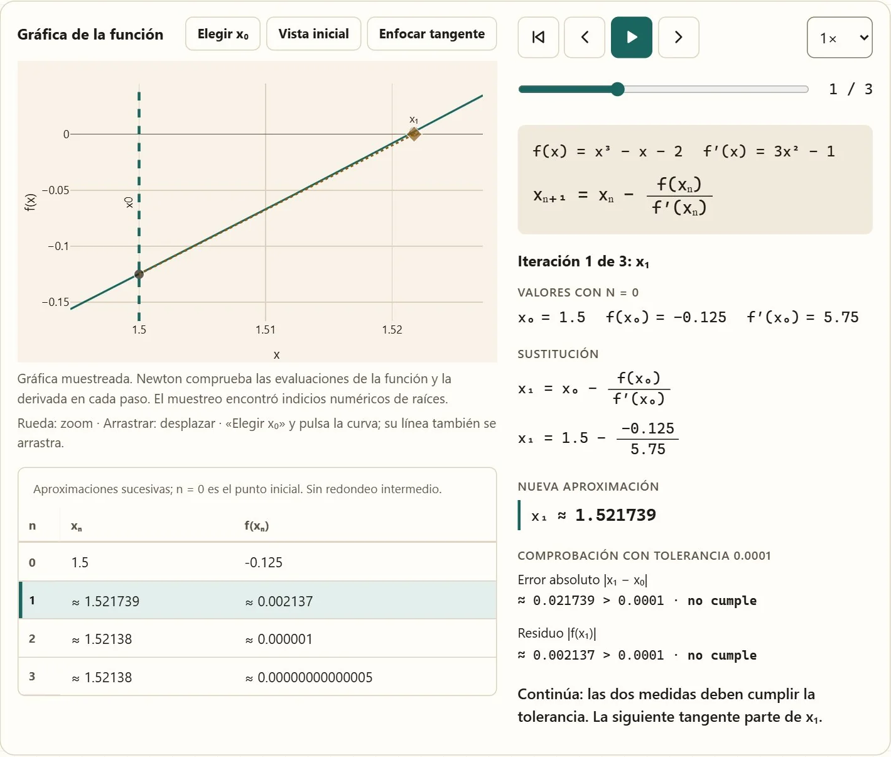
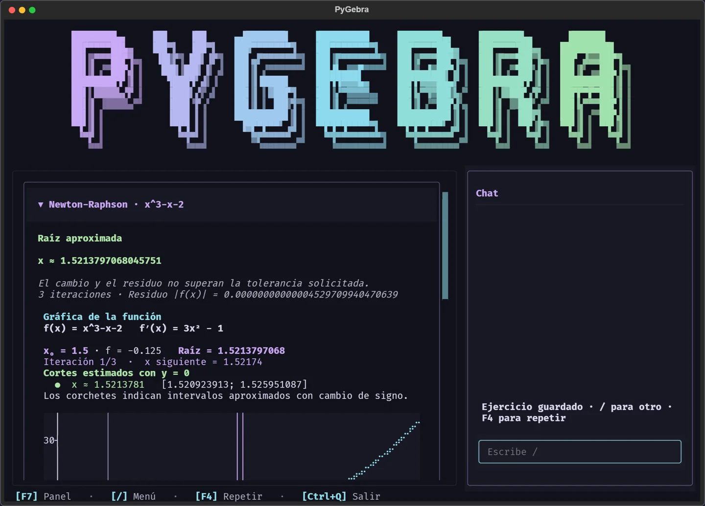
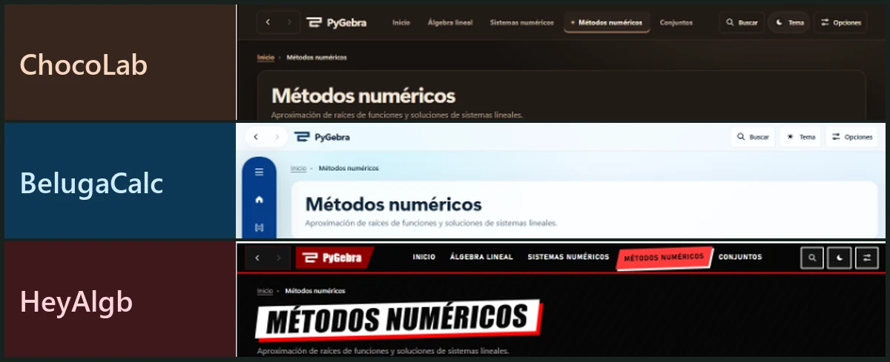

<h1 align="center">
  
</h1>

Calculadora educativa de **álgebra lineal, métodos numéricos y conjuntos**.
Escribe un ejercicio y sigue las operaciones que llevan a su resultado, desde una
reducción por filas hasta la tangente de Newton. Desarrollada por estudiantes de
Ingeniería en Sistemas.

**[Descargar para Windows](https://github.com/Collado-Labs/Algebra-Lineal/releases/latest)** ·
[Documentación](docs/README.md) · [Desarrollo local](#desarrollo-rápido) ·
[Contribuir](CONTRIBUTING.md)

## Una raíz, paso a paso

Partimos de $f(x) = x^3 - x - 2$ y $x_0 = 1.5$. El **método de Newton-Raphson**
muestra la derivada, la tangente y la sustitución de cada paso. En la primera
iteración, $x_1 \approx 1.521739$. La tabla y el reproductor permiten volver
a ese paso y seguir cómo cambia la aproximación.

[](docs/capturas/raices/09-newton-sustitucion-estudio-1280.jpg)

[Guía de Newton-Raphson](docs/newton-raphson.md) ·
[Secante en WebView2 (v0.18.0)](docs/capturas/raices/18-secante-webview2.jpg)

## Formas de usar el proyecto

| Interfaz | Uso |
| --- | --- |
| Escritorio Windows | Herramientas visuales en una ventana local. |
| Django en desarrollo | La misma interfaz desde el navegador local. |
| Terminal | Matrices y sistemas por Gauss y Gauss-Jordan. |

La interfaz visual incluye tema claro/oscuro, búsqueda de herramientas y
teclado matemático contextual.

### Consola interactiva · En desarrollo

Rodolfo Collado está desarrollando una nueva interfaz de terminal en
el [PR #131](https://github.com/Collado-Labs/Algebra-Lineal/pull/131). El prototipo
abre un catálogo con «/», muestra resultados, gráficas y tablas navegables, y
guarda ejercicios en un historial local. Su paleta pastel y sus paneles adaptables
están pensados para trabajar con el teclado.

[](https://github.com/Collado-Labs/Algebra-Lineal/pull/131)

*El mismo ejercicio de Newton-Raphson resuelto en el prototipo del PR #131.*

## Cinco estilos de interfaz

**Estudio** acompaña el procedimiento paso a paso. **Minimalista** reduce la
interfaz a lo esencial. Los estilos homenaje **ChocoLab**, **BelugaCalc** y
**HeyAlgb** cambian la apariencia y la navegación. Los cinco tienen tema claro y
oscuro y se eligen en **Opciones → Apariencia**.

[](docs/temas-homenaje.md)

[Estudio y Minimalista en claro y oscuro](docs/capturas/temas-homenaje/estudio-minimalista-herramienta.png) ·
[Galería y créditos de los temas homenaje](docs/temas-homenaje.md)

## Qué puedes resolver

- **Álgebra lineal.** Opera con matrices y vectores, compara Gauss con Gauss-Jordan y
  resuelve $Ax = b$. Calcula determinantes e inversas y comprueba los resultados.
- **Métodos numéricos.** Busca raíces con Bisección, Regla falsa, Newton-Raphson
  y Secante. Compara Jacobi y Gauss-Seidel con tablas y sustituciones.
- **Sistemas numéricos.** Convierte entre bases 2, 8, 10 y 16, y entre números
  arábigos y romanos.
- **Conjuntos.** Trabaja con operaciones, intervalos, cardinalidad y diagramas
  de Venn editables.

En álgebra lineal puedes alternar entre fracciones exactas y decimales.
Consulta las [herramientas y ejemplos](docs/funcionalidades.md).

## Instalación en Windows

Descarga **PyGebra-Setup-\<versión\>.exe** desde
[GitHub Releases](https://github.com/Collado-Labs/Algebra-Lineal/releases/latest),
ejecútalo y abre PyGebra desde el menú Inicio. El instalador incluye Python y
las dependencias. La aplicación funciona sin conexión una vez instalada.

Requiere Windows 10 1809 o posterior, o Windows 11, con soporte para
aplicaciones x64. Si falta WebView2, su instalación requiere Internet.
El instalador no tiene firma digital.

[Requisitos e instalación](docs/instalacion-windows.md) ·
[Verificar la descarga con SHA-256](docs/releases.md#verificar-una-descarga)

## Desarrollo rápido

El motor matemático está en **Python**. La interfaz visual se ejecuta con
**Django** y en Windows se abre en una ventana **WebView2** mediante
**pywebview**. La distribución usa **PyInstaller** e **Inno Setup**.

Con Git y [uv](https://docs.astral.sh/uv/) instalados:

```bash
git clone https://github.com/Collado-Labs/Algebra-Lineal.git
cd Algebra-Lineal
git switch develop
uv sync --locked
uv run --locked python manage.py runserver
```

Abre <http://127.0.0.1:8000/>. uv puede instalar la versión de Python indicada en
`.python-version`.

[Ejecutar desde el código fuente](docs/ejecucion.md) ·
[Arquitectura](docs/arquitectura.md) · [Pruebas](docs/pruebas.md)

## Contribuir

Parte de **develop** y abre el PR hacia esa rama. La
[guía de contribución](CONTRIBUTING.md) explica el flujo, las verificaciones y los
criterios que conservan los procedimientos matemáticos.
