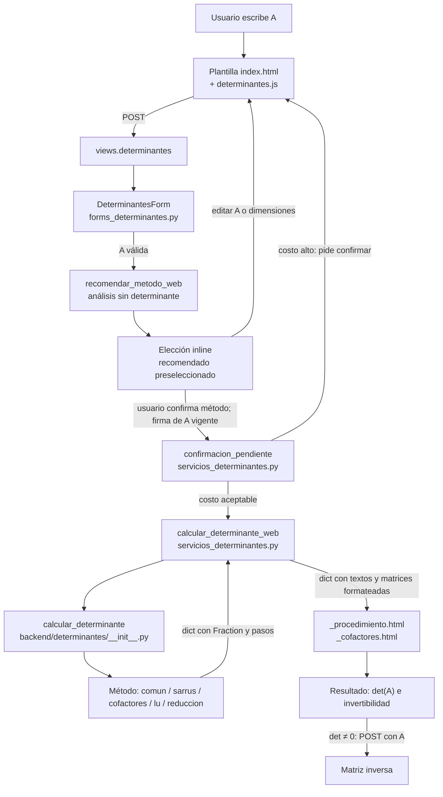
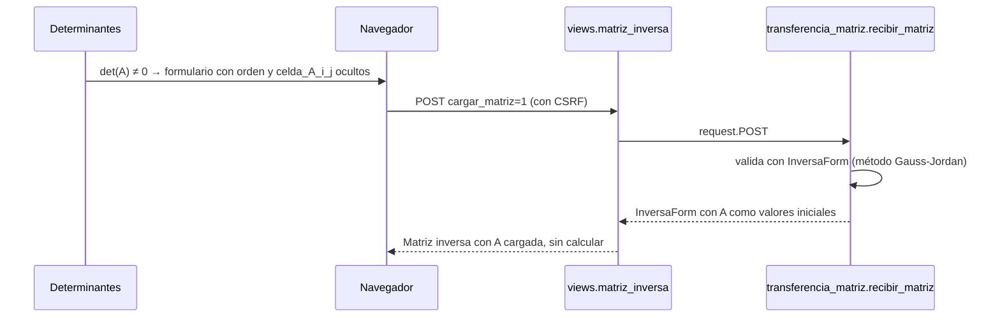

# Determinantes

[Índice de documentación](README.md) · [Matriz inversa](matriz-inversa.md) ·
[Presupuesto computacional](presupuesto-computacional.md) ·
[Protección numérica común](seguridad-numerica.md)

**Determinantes** (`/matrices/determinantes/`) calcula det(A) de una matriz
cuadrada A con cinco métodos. Está en **Álgebra lineal → Matrices →
Determinantes**, después de Matriz inversa. Todo es exacto (`Fraction`), sin
librerías externas de álgebra y sin conexión a internet.

Esta guía sigue a la matriz A desde que se escribe hasta que aparece el
resultado. Está pensada para alguien que está aprendiendo a programar y tiene
que explicar el código: cada sección dice **qué archivo** hace el trabajo,
**qué recibe** y **qué devuelve**.

| Método | Tamaños | Idea |
| --- | --- | --- |
| Fórmula directa 2×2 | solo 2×2 | $\det(A) = ad - bc$ |
| Regla de Sarrus | solo 3×3 | tres diagonales que suman menos tres que restan |
| Cofactores | 1×1 a 6×6 | desarrollar por una fila o una columna |
| Factorización LU | todos | $A = LU$ sin intercambios; $\det(A) = \det(U)$ |
| Reducción por filas | todos | triangularizar sin normalizar; producto de la diagonal y signo de los intercambios |

Todos los métodos que se pueden aplicar a la misma A dan **exactamente** el
mismo determinante; las pruebas lo comprueban contra una fórmula independiente.

## El recorrido completo de A



Cada capa tiene una sola responsabilidad:

| Capa | Archivo | Recibe | Devuelve |
| --- | --- | --- | --- |
| Entrada | [`index.html`](../frontend/web/calculadora/templates/calculadora/modules/determinantes/index.html), [`determinantes.js`](../frontend/web/calculadora/static/calculadora/determinantes.js) | lo que escribe el usuario | primero `orden` y `celda_A_i_j`; después `eleccion`, `metodo` y `expansion` |
| Validación | [`forms_determinantes.py`](../frontend/web/calculadora/forms_determinantes.py) | el POST (texto) | `entrada = {"a": [[Fraction…]], "metodo": …, "expansion": …}` o errores por campo |
| Vista | [`views.py`](../frontend/web/calculadora/views.py) (`determinantes`) | la petición HTTP | la página renderizada |
| Presupuesto | [`servicios_determinantes.py`](../frontend/web/calculadora/servicios_determinantes.py) (`confirmacion_pendiente`) y [`presupuesto.py`](../backend/determinantes/presupuesto.py) | `entrada` | `None` (calcular ya) o el aviso de confirmación |
| Recomendación | [`recomendacion.py`](../backend/determinantes/recomendacion.py) (`analizar_matriz_para_determinante`) | A válida | método recomendado, razón estructurada y costes internos; sin det(A) |
| Cálculo | [`backend/determinantes/`](../backend/determinantes/__init__.py) y [`factorizacion_lu.py`](../backend/factorizacion_lu.py) | A con `Fraction` | un diccionario con `determinante` y la evidencia del método |
| Presentación | [`servicios_determinantes.py`](../frontend/web/calculadora/servicios_determinantes.py) (`calcular_determinante_web`) | ese diccionario | textos y matrices ya formateados, sin HTML |
| Vista del procedimiento | [`_procedimiento.html`](../frontend/web/calculadora/templates/calculadora/modules/determinantes/_procedimiento.html), [`_cofactores.html`](../frontend/web/calculadora/templates/calculadora/modules/determinantes/_cofactores.html) | los textos preparados | el HTML: entrada → procedimiento plegable → resultado |

La regla más importante: **el backend no escribe HTML ni frases de interfaz**.
Devuelve números exactos y estructuras (listas, diccionarios). Las frases como
«det quedó multiplicado por…» se escriben en el servicio web.

## 1. Dónde entra A

La plantilla [`index.html`](../frontend/web/calculadora/templates/calculadora/modules/determinantes/index.html)
reutiliza los componentes de Matriz inversa:

- el control **Filas y columnas** (`modules/matrices/_dimension.html`, con −
  y +), de 1 a 10;
- la cuadrícula `components/matriz_entrada.html`, con una celda por entrada:
  `celda_A_0_0`, `celda_A_0_1`, …;
- el teclado matemático, la selección matricial y el pegado, iguales que en
  las demás herramientas de matrices;
- un único botón principal, **Calcular determinante**. Los métodos aparecen
  después de validar y analizar A, dentro del mismo formulario.

La segunda etapa pregunta **¿Cómo quieres calcular el determinante?**. Muestra
una explicación breve, el método recomendado preseleccionado y marcado con
**Recomendado**, y todos los métodos disponibles para ese tamaño. **Calcular
con este método** confirma la elección. La recomendación no desactiva alternativas
ni cambia una elección manual. Con Cofactores aparece **Desarrollar por**
(Automático, Fila 1…n, Columna 1…n). El disclosure **¿Por qué recomendamos este
método?** permite profundizar sin mostrar los costes internos de la heurística.

[`determinantes.js`](../frontend/web/calculadora/static/calculadora/determinantes.js)
solo mejora la interacción; nunca calcula:

- al cambiar el tamaño redibuja A con las plantillas inertes del servidor y
  conserva lo escrito;
- al editar una celda o las dimensiones oculta y desactiva la etapa anterior,
  anuncia el cambio y devuelve el botón a **Calcular determinante**;
- muestra **Desarrollar por** inmediatamente al seleccionar Cofactores. Las
  opciones llegan del servidor; JS no reproduce la heurística;
- lleva el foco a la elección tras analizar A y conserva el foco al editarla;
- conserva el menú contextual, la selección, el pegado y Deshacer. Restaurar
  celdas no reactiva una elección invalidada.

Sin JavaScript, **Aplicar** pide al servidor la nueva estructura. El primer
POST devuelve la elección y el segundo calcula con el método elegido. CSS
muestra el selector de expansión al marcar Cofactores. Si se editó A antes del
segundo POST, el servidor vuelve a analizarla y exige confirmar de nuevo.

## 2. Quién valida

[`DeterminantesForm`](../frontend/web/calculadora/forms_determinantes.py)
hereda de `FormularioCeldas`, la base que comparten Operaciones con matrices,
Resolver Ax = b y Matriz inversa. Valida en este orden:

1. **Campos repetidos** y tamaño (`campo_dimension`, de 1 a 10).
2. **Método disponible**, requerido únicamente en la etapa de elección,
   para ese tamaño (`metodo_disponible`). Un POST
   manipulado, por ejemplo Sarrus con A 2×2, se rechaza con un mensaje en el
   campo Método.
3. **Contrato estricto**: llegan exactamente las celdas de A, ni más ni menos,
   y ningún campo desconocido (`celdas_coinciden`).
4. **Números exactos**: cada celda pasa por el parser común
   (`convertir_a_numero`), que admite enteros, fracciones y decimales con
   punto y rechaza literales enormes antes de convertirlos.

Si todo es válido, el formulario entrega `cleaned_data["entrada"]`:

```python
{"a": [[Fraction(2), Fraction(1)], [Fraction(0), Fraction(4)]],
 "metodo": "cofactores", "expansion": "fila_1"}
```

`expansion` solo se conserva con Cofactores; con los demás métodos vale `"auto"`.

## 3. Quién selecciona el método

Hay tres decisiones distintas:

- **La interfaz** decide qué métodos ofrecer según el tamaño
  (`metodo_disponible` en el formulario). No pide una elección antes de leer A.
  `RadiosPorTamano`, `metodo_sugerido` y `metodos_determinantes.js` siguen
  compartidos con Cramer; su comportamiento no cambia.
- **El recomendador** analiza los valores de A al pulsar **Calcular
  determinante**. El servicio web convierte su razón estructurada en una
  explicación principal y un detalle opcional. La vista preselecciona el
  recomendado solo al abrir una elección nueva. No calcula det(A) ni consulta
  el presupuesto. Si hubiera un único método disponible, la vista lo usaría
  directamente, sin inventar una etapa de elección por tamaño.
- **El backend** ejecuta el método pedido. En
  [`backend/determinantes/__init__.py`](../backend/determinantes/__init__.py),
  `calcular_determinante(a, metodo, expansion)` valida A con `preparar`,
  busca la función en el diccionario `METODOS` y la llama:

```python
METODOS = {"directo_2x2": directo_2x2, "cofactores": cofactores,
           "sarrus": sarrus, "lu": lu, "reduccion": reduccion}
```

La vista vincula la etapa a A mediante `firmar_matriz`: un HMAC SHA-256 de las
dimensiones y las celdas escritas. Esta firma no incluye método ni expansión,
para permitir cambiar ambos. Si falta o no coincide, el POST solo analiza A
y abre una elección nueva. Incluso cambiar `2` por `2.0` invalida la firma.
No se guardan sesiones ni matrices. Un método previo sin firma vigente no
autoriza calcular. La confirmación de presupuesto conserva su firma distinta,
que sí incluye A exacta, método y expansión.

Un método desconocido lanza `ValueError("Selecciona un método válido…")`.
Además, cada método vuelve a comprobar su propia condición (Sarrus exige 3×3,
la fórmula directa 2×2 y Cofactores como máximo 6×6), así que el backend es
seguro aunque alguien lo use sin la interfaz.

### Heurística de recomendación

[`analizar_matriz_para_determinante(A)`](../backend/determinantes/recomendacion.py)
está exportada por `backend.determinantes`, pero el cálculo no la llama. Usa
la validación común (`preparar`) y devuelve, por ejemplo:

```python
{"metodo_recomendado": "cofactores", "razon": "expansion_favorable",
 "expansion": {"eje": "fila", "indice": 1, "ceros": 2},
 "costos": {"cofactores": 12, "sarrus": 25}, "lu": None}
```

La razón es un código estable; `recomendar_metodo_web` lo convierte en una
frase educativa y un detalle opcional. La explicación principal solo requiere
conocer el método recomendado; las comparaciones quedan en el detalle.
La plantilla solo presenta esos datos. Elegir otro método,
incluida otra fila o columna de Cofactores, conserva el procedimiento elegido.

| Razón | Explicación principal |
| --- | --- |
| `unico_elemento` | La matriz tiene un único elemento: ese es su determinante. |
| `formula_directa` | Para una matriz 2×2 existe una fórmula directa: multiplica las dos diagonales y resta sus productos. |
| `sarrus` | Tu matriz es 3×3, el tamaño para el que se diseñó la Regla de Sarrus. Puedes calcular el determinante siguiendo sus seis diagonales. |
| `expansion_favorable` | La fila/columna N contiene K ceros. Al desarrollar por esa fila/columna, los términos con cero se anulan y el procedimiento se hace más corto. |
| `expansion_favorable`, sin ceros | Al desarrollar esta matriz por una fila o columna, el cálculo se divide en determinantes de matrices más pequeñas. |
| `lu_sin_intercambios` | Esta matriz puede factorizarse sin intercambiar filas. Para este tamaño, LU organiza el cálculo en pasos más manejables. |
| `lu_necesita_intercambio` | La reducción por filas permite reorganizar las filas y continuar el cálculo. En esta matriz, LU necesitaría un intercambio de filas. |
| `triangular_superior` | La matriz ya es triangular superior. No necesitas eliminar entradas: el determinante se obtiene multiplicando los valores de la diagonal principal. |
| `lu_no_verificada` | La reducción por filas permite eliminar las entradas debajo de la diagonal y continuar con el cálculo. |

Se aplican estas reglas, en orden:

1. **1×1:** Cofactores devuelve el único elemento. **2×2:** fórmula directa.
2. **Triangular superior, desde 3×3, con los primeros n−1 elementos de la
   diagonal no nulos:** Reducción por filas, porque su motor no necesita
   eliminar ni intercambiar; solo obtiene el producto diagonal. El último
   elemento puede ser cero. Un cero diagonal anterior pasa por la comparación
   general: saltar columnas puede generar eliminaciones incluso en una triangular.
3. **3×3:** se compara Sarrus con el desarrollo automático de Cofactores.
   En una matriz densa se prefiere Sarrus; una línea con ceros reduce el
   trabajo de Cofactores. En empate se elige Cofactores.
4. **Desde 4×4:** se comprueba LU mediante una eliminación exacta sobre una
   copia, sin L, pasos ni determinante. Se respeta el avance separado de fila
   y columna: una columna nula se salta; un pivote cero con alguna entrada
   no nula debajo excluye LU, incluso si aparece después de varias etapas.
5. Se compara Cofactores (hasta **6×6**) con LU cuando se ha comprobado que
   puede continuar sin intercambios. Si LU está excluida, se compara con una
   cota de Reducción. En empate se elige Cofactores. Por encima de 6×6 solo
   se consideran LU y Reducción.

Los **costes son unidades de utilidad didáctica**, no segundos ni cotas de
memoria. Cofactores cuenta una suma por término (también si es cero), dos
productos por término no nulo, las celdas de cada menor que se muestra y el
coste de sus hijos. Cada hijo vuelve a elegir la línea con más ceros mediante
`elegir_expansion`; los hijos 2×2 cuentan las tres operaciones de `ad − bc`.
Por eso una sola fila favorable en una 6×6 puede seguir dejando un menor
denso demasiado largo: no basta con contar ceros en la matriz inicial.

Sarrus cuenta sus **25 operaciones**: 18 multiplicaciones, seis sumas y una
resta, tal como las ejecuta el motor. LU cuenta los cocientes por etapa, el
producto diagonal y **4n** operaciones por reemplazo (la fila completa de U
y la repetición sobre L para verificar L→I). Reducción usa la cota
`n + n(n−1)/2 · (1 + 2n)` para sus divisiones, reemplazos y producto diagonal.
Los motores y sus procedimientos permanecen intactos.

La prioridad es didáctica: **LU es el método de clase para matrices grandes
cuando es aplicable**, aunque Reducción pueda requerir menos operaciones al
omitir L y su verificación. Reducción queda como alternativa si LU necesita
un intercambio, o como atajo en una triangular superior. Una triangular
inferior se analiza mediante sus menores y pivotes, porque el motor de
Reducción sí tendría que eliminar debajo de su diagonal.

La comprobación respeta los límites de aritmética exacta. Si alcanza un
límite, LU queda **sin verificar** (`aplicable=None`), no se confunde con un
intercambio y no se recomienda. La recomendación tampoco garantiza que el
cálculo seleccionado evite todo crecimiento numérico: cada motor conserva
sus propias comprobaciones. El presupuesto sigue teniendo una tarea distinta:
avisar si **el método elegido** será pesado, sin comparar métodos ni cambiarlo.

## 4. Qué archivo calcula

| Archivo | Función | Devuelve, además de `determinante` |
| --- | --- | --- |
| [`comun.py`](../backend/determinantes/comun.py) | `preparar`, `producto`, `directo_2x2`, `determinante_desde_reduccion` | `ad`, `bc` |
| [`sarrus.py`](../backend/determinantes/sarrus.py) | `sarrus` | `positivas` y `negativas`: posiciones, valores y producto de cada diagonal |
| [`cofactores.py`](../backend/determinantes/cofactores.py) | `cofactores`, `menor`, `elegir_expansion` | `eje`, `indice`, `automatico` y la lista de `terminos` |
| [`lu.py`](../backend/determinantes/lu.py) | `lu` | `l`, `u`, `pasos`, `etapas`, `verificacion`, `diagonal` o `pivote_nulo` |
| [`reduccion.py`](../backend/determinantes/reduccion.py) | `reduccion` | `u`, `pasos`, `intercambios`, `signo`, `diagonal`, `producto_diagonal` |
| [`triangularizacion.py`](../backend/determinantes/triangularizacion.py) | `triangularizar` | `u`, `pasos`, `intercambios` (sin calcular el determinante) |
| [`factorizacion_lu.py`](../backend/factorizacion_lu.py) | `factorizar_lu` | `aplicable`, `l`, `u`, `pasos`, `etapas`, `verificacion`, `pivote_nulo` |
| [`presupuesto.py`](../backend/determinantes/presupuesto.py) | `estimar_determinante` | una `Estimacion` (no calcula) |

Toda la aritmética usa `sumar_exacto`, `restar_exacto`, `multiplicar_exacto`
y `dividir_exacto` de
[`seguridad_numerica.py`](../backend/seguridad_numerica.py): si un número
crece más de lo permitido (`BITS_MAXIMOS`), se lanza un `ValueError` con un
mensaje legible en vez de bloquear la aplicación.

`calcular_determinante` siempre devuelve `metodo`, `matriz` (A con
`Fraction`) y `aplicable`. Solo LU puede devolver `aplicable = False`.

## 5. Cómo se almacenan los pasos

Hay dos formas de evidencia, según el método:

**Operaciones por filas (LU y Reducción).** Reutilizan
[`operaciones_filas.py`](../backend/operaciones_filas.py), el mismo módulo de
Gauss y Gauss-Jordan. Cada operación llama a `registrar_paso`, que guarda una
copia de la matriz antes y después:

```python
{"antes": [[0, 2], [3, 4]], "operacion": "F1 <-> F2",
 "despues": [[3, 4], [0, 2]], "correccion_determinante": -1}
```

En Determinantes los intercambios añaden `correccion_determinante = -1`.
Los reemplazos `Fi = Fi − k·Fj` no lo añaden porque no cambian el determinante.
La primitiva compartida conserva además la anotación de las normalizaciones
que usan Gauss y Gauss-Jordan en otros módulos, incluida Matriz inversa.
El método de Determinantes por reducción no las ejecuta.

**Árbol de cofactores.** Cada término guarda su posición, el elemento, la
matriz `menor`, el `signo`, el valor del menor, el `cofactor`, la
`contribucion` y un `hijo` con la evidencia de cómo se calculó ese menor:

```python
{"fila": 1, "columna": 2, "elemento": Fraction(2), "menor": [[4, 6], [7, 10]],
 "signo": -1, "valor_menor": Fraction(-2), "cofactor": Fraction(2),
 "contribucion": Fraction(4), "hijo": {"matriz": …, "ad": …, "bc": …, "determinante": …}}
```

## 6. Quién prepara los pasos para la vista

[`servicios_determinantes.py`](../frontend/web/calculadora/servicios_determinantes.py)
convierte el diccionario del backend en textos listos para mostrar.
`calcular_determinante_web(entrada)`:

1. llama a `calcular_determinante`;
2. usa `PRESENTAR[metodo]` (`_directo_2x2`, `_sarrus`, `_cofactores`, `_lu` o
   `_reduccion`) para escribir las líneas del procedimiento, por ejemplo
   `"det(A) = ad − bc = 3·6 − 4·5 = 18 − 20 = -2"`;
3. formatea matrices y números con `formatear_matriz` y `formatear_exacto`
   (los mismos de toda la aplicación);
4. añade `determinante`, `invertible` y, si det(A) ≠ 0, `transferencia`: los
   campos ocultos para enviar A a Matriz inversa.

No recalcula nada: cada número que escribe ya venía del backend.

La adaptación común está en `presentar_determinante(calculo, nombre="det(A)")`.
Recibe evidencia existente, formatea los pasos y permite nombrar el
determinante D o Dᵢ. `calcular_determinante_web` la usa y añade la transferencia
a Matriz inversa, que solo pertenece a esta vista. **Regla de Cramer** en
[Resolver Ax = b](funcionalidades.md#resolver-ax--b) también la usa: calcula D
y cada Dᵢ con este motor y embebe `_procedimiento.html` en disclosures anidados,
sin volver a ejecutar ni reconstruir los algoritmos. Cramer resuelve Ax=b;
no es otro método para calcular det(A). Todos sus determinantes usan el mismo
método elegido y requieren D≠0 para obtener x; con D=0 recomienda Gauss o
Gauss-Jordan para clasificar.

## 7. Qué plantilla lo muestra

El resultado sigue el patrón de PyGebra:

1. encabezado: «Determinantes · Método» y «Determinante de A (n×n)»;
2. el selector Exacto / Decimal (`numeric_format.html`);
3. **Ver procedimiento**, cerrado (``), con
   [`_procedimiento.html`](../frontend/web/calculadora/templates/calculadora/modules/determinantes/_procedimiento.html);
   Cofactores usa además
   [`_cofactores.html`](../frontend/web/calculadora/templates/calculadora/modules/determinantes/_cofactores.html),
   que se incluye a sí misma para los menores grandes;
4. **Resultado**, una sola vez: `det(A) = …` y si A es invertible.

## Los cinco métodos

### Fórmula directa 2×2

Para

$$A = \begin{pmatrix} a & b \\ c & d \end{pmatrix}, \qquad \det(A) = ad - bc.$$

`directo_2x2` en [`comun.py`](../backend/determinantes/comun.py) devuelve
`ad`, `bc` y su diferencia. Es la **única** implementación de `ad − bc` del
proyecto: la usan Determinantes, los menores 2×2 de Cofactores y la regla 2×2
de Matriz inversa.

### Cofactores

**Menor.** $M_{ij}$ es el determinante de la matriz que queda al quitar la
fila $i$ y la columna $j$. En código, `menor(a, fila, columna)` filtra esa
fila y esa columna:

```python
[[v for j, v in enumerate(f) if j != columna] for i, f in enumerate(a) if i != fila]
```

**Signo.** El cofactor es $C_{ij} = (-1)^{i+j} M_{ij}$. El signo forma un
tablero: + en las posiciones donde $i + j$ es par y − donde es impar.

$$\begin{pmatrix} + & - & + \\ - & + & - \\ + & - & + \end{pmatrix}$$

**Desarrollo.** Por la fila $i$: $\det(A) = \sum_j a_{ij} C_{ij}$. Por la
columna $j$: $\det(A) = \sum_i a_{ij} C_{ij}$. Cualquier fila o columna da
el mismo resultado.

**Elección.** Con **Automático**, `elegir_expansion` cuenta los ceros de cada
fila y cada columna y elige la que tiene más, porque cada cero ahorra un
menor. En un empate gana la primera en el orden Fila 1, …, Fila n, Columna 1,
…, Columna n (`max` de Python conserva el primer máximo). También se puede
elegir **Fila n** o **Columna n**.

**Recursión.** Para calcular cada menor:

- 1×1: es su única entrada;
- 2×2: `ad − bc` con `directo_2x2`;
- 3×3 o más: se vuelve a desarrollar por cofactores (en Automático).

Un elemento igual a 0 aporta 0 y su menor no se calcula. En la interfaz, los
menores de 3×3 o más se explican dentro de un desplegable cerrado «Cómo se
obtiene Mᵢⱼ»; dentro de él las entradas se llaman $m_{ij}$ porque sus
posiciones se cuentan en el propio menor.

**Costo.** Una matriz n×n tiene n menores de (n−1)×(n−1), cada uno con n−1
menores… el número de menores crece como n!. Por eso Cofactores admite como
máximo 6×6 (`ORDEN_MAXIMO_COFACTORES`) y el presupuesto avisa antes de los
cálculos largos.

### Regla de Sarrus

Solo existe para 3×3. Se copian las dos primeras columnas a la derecha y se
multiplican las diagonales:

$$\det(A) = (a_{11}a_{22}a_{33} + a_{12}a_{23}a_{31} + a_{13}a_{21}a_{32}) - (a_{11}a_{23}a_{32} + a_{12}a_{21}a_{33} + a_{13}a_{22}a_{31})$$

En [`sarrus.py`](../backend/determinantes/sarrus.py) las posiciones se
calculan con `(i, (j + dirección·i) % 3)`: con dirección 1 salen las diagonales
↘ y con −1 las ↙. El módulo 3 hace el papel de las columnas repetidas.

En la interfaz (`_sarrus_matriz.html`), las copias se rotulan otra vez **C1** y
**C2**, atenuadas y detrás de una línea vertical, y conservan sus índices
(`a₁₁`, nunca `a₁₄`): no son columnas nuevas. Cada diagonal se dibuja con un SVG
detrás de los números, con un trazo propio (continuo, discontinuo o punteado)
que se repite junto a su producto en la lista, así que no depende del color.

### Factorización LU

[`factorizacion_lu.py`](../backend/factorizacion_lu.py) recibe una A de
$m\times n$ y construye $A = LU$: L tiene tamaño $m\times m$ y es triangular
inferior **unitaria**; U tiene tamaño $m\times n$ y queda **escalonada**.
Para una A cuadrada, U es triangular superior.

La construcción sigue el procedimiento de clase:

1. L empieza como la identidad y U como una copia exacta de A.
2. En la fila pivote $r$ y columna pivote $c$, se toma $p = u_{rc}$ y las
   entradas $u_{ic}$ desde esa fila hacia abajo, **antes** de eliminarlas.
3. Se divide cada entrada entre $p$: $l_{ir} = u_{ic}/p$. El primer cociente
   es $p/p = 1$ y los siguientes completan la **columna r de L**.
4. Con esos cocientes se aplican $F_i \leftarrow F_i - l_{ir}F_r$ a U.
   No se intercambia ni se normaliza ninguna fila.
5. Se avanza la fila pivote. Las columnas nulas desde esa fila hacia abajo
   se saltan sin avanzar la fila: $r$ y $c$ pueden ser distintos.

Cada `etapa` guarda `u_antes`, `fila_pivote`, `columna_pivote`, `pivote`,
`columna_l`, las `entradas` con su `entrada`, `cociente` y `posicion_l`, y
las `operaciones` con fila destino, fila pivote y factor exacto. Todas las
posiciones de esta evidencia empiezan en 1. Los `pasos` conservan además
las matrices antes y después de cada reemplazo.

La interfaz muestra las divisiones y los reemplazos por columna antes de
presentar $A = LU$. El backend aplica **la misma secuencia** de reemplazos
a L y guarda una `verificacion` compacta: `l_reducida`, `es_identidad` y
cantidad de `reemplazos`, sin guardar otro historial de matrices.
Se muestra el estado final $L\to I$: como las mismas operaciones llevan
$A\to U$, esto verifica $A = LU$.

**Ejemplo de las diapositivas (4×5).**

```text
A = [ 2   4  -1   5  -2 ]    L = [ 1   0   0   0 ]    U = [ 2   4  -1   5  -2 ]
    [-4  -5   3  -8   1 ]        [-2   1   0   0 ]        [ 0   3   1   2  -3 ]
    [ 2  -5  -4   1   8 ]        [ 1  -3   1   0 ]        [ 0   0   0   2   1 ]
    [-6   0   7  -3   1 ]        [-3   4   2   1 ]        [ 0   0   0   0   5 ]
```

Los pivotes están en (1,1), (2,2), (3,4) y (4,5). En la tercera etapa se
divide 2/2 = 1 y 4/2 = 2: esos cocientes van a la **columna 3 de L**,
aunque provengan de la columna 4 de U. Las pruebas verifican exactamente
el producto $LU = A$ y los reemplazos $A\to U$, $L\to I$.

**Por qué no intercambia.** Si $u_{rc}$ es 0 y hay una entrada no nula
debajo, el helper se detiene con `aplicable = False` y
`pivote_nulo = {"fila": r, "columna": c}`. No transforma el problema en
$PA = LU$. La interfaz explica el motivo y sugiere Reducción por filas o
Cofactores. Si toda la columna restante es nula, se salta esa columna.

**Determinantes sigue siendo cuadrado:** `lu` valida esa condición antes de
llamar al helper. Como $\det(L) = 1$, $\det(A) = \det(L)\det(U) = \det(U)$.
El producto de la diagonal se muestra en el procedimiento y el determinante
final en Resultado.

El helper está fuera del paquete `determinantes` y no depende de él.
Resolver Ax = b también lo reutiliza para obtener $A=LU$, antes de resolver
$Ly=b$ y $Ux=y$ mediante las matrices aumentadas de ambas etapas.

### Reducción por filas

[`triangularizacion.py`](../backend/determinantes/triangularizacion.py)
obtiene U con las operaciones de clase: conserva los pivotes y elimina
debajo mediante reemplazos $F_i \leftarrow F_i - kF_r$, con
$k = u_{ic}/u_{rc}$. Solo intercambia cuando el pivote actual es 0 y hay
una entrada no nula debajo. Si toda la columna restante es nula, la salta.

| Operación | Ejemplo | Efecto en det |
| --- | --- | --- |
| Reemplazo | `F2 = F2 - (2)F1` | no cambia |
| Intercambio necesario | `F1 <-> F2` | cambia el signo |

**No normaliza filas.** Comparte `buscar_fila_pivote`, `intercambiar_filas`
y `reemplazar_fila` con los otros algoritmos, pero no llama a
`aplicar_gauss` ni cambia el Gauss/Gauss-Jordan de Reducción, Matriz inversa
o Resolver Ax = b.

[`reduccion.py`](../backend/determinantes/reduccion.py) toma esa evidencia,
calcula el producto exacto de la diagonal y aplica el signo correspondiente
a la cantidad `intercambios` ($s$):

$$\det(U) = \prod_i u_{ii}, \qquad \det(A) = (-1)^s\det(U).$$

Para $A = \begin{pmatrix} 0 & 2 \\ 3 & 4 \end{pmatrix}$ solo hace
`F1 <-> F2`, deja $U = \begin{pmatrix} 3 & 4 \\ 0 & 2 \end{pmatrix}$,
obtiene $\det(U) = 3\cdot2 = 6$ y aplica $(-1)^1\cdot6 = -6$.
La interfaz muestra las operaciones, cada cambio de signo, U, su producto
diagonal y el ajuste $(-1)^s$. El determinante final aparece en Resultado.

Si la diagonal tiene un 0, el producto es nulo y el ajuste de signo lo
conserva.

## Por qué se multiplica la diagonal de una matriz triangular

En una matriz triangular superior, al desarrollar por cofactores la primera
columna solo queda el término de $a_{11}$ (los demás elementos son 0), y su
menor vuelve a ser triangular. Repitiendo:

$$\det\begin{pmatrix} u_{11} & u_{12} & u_{13} \\ 0 & u_{22} & u_{23} \\ 0 & 0 & u_{33} \end{pmatrix} = u_{11}\,u_{22}\,u_{33}$$

Por eso LU y Reducción terminan multiplicando la diagonal de U.

## Relación con Matriz inversa

El criterio es $A$ invertible $\Leftrightarrow \det(A) \neq 0$. Matriz inversa
lo muestra en su resultado, **sin quitar** su propia evidencia:

- el determinante **explica** por qué A es (o no es) invertible;
- Gauss-Jordan sobre `[A | I] → [I | A⁻¹]` (o la regla 2×2) **construye y
  comprueba** la inversa.

Cómo comparten lógica:

- `inversa_metodo_2x2` llama a `directo_2x2`: no hay otro `ad − bc`.
- `inversa_gauss_jordan` obtiene det(A) de los pasos que ya registró
  Gauss-Jordan con `determinante_desde_reduccion` (las eliminaciones hacia
  arriba son reemplazos y no cambian det). No hace otra reducción. Ese trabajo
  extra es, como mucho, n + pasos productos, un término menor que la cota de
  Gauss-Jordan, por eso el presupuesto de la inversa no cambia.
- El catálogo relaciona las dos herramientas en ambos sentidos.

### De Determinantes a Matriz inversa



- Solo se ofrece **«Calcular su matriz inversa»** cuando det(A) ≠ 0. Con
  det(A) = 0 el resultado dice que A no es invertible y no hay botón.
- Es un POST **efímero**: no hay sesión, base de datos ni archivo. Las celdas
  viajan como fracciones exactas (`str(Fraction)`, por ejemplo `1/2`).
- [`transferencia_matriz.py`](../frontend/web/calculadora/transferencia_matriz.py)
  valida con el mismo `InversaForm` de siempre: un POST manipulado muestra los
  errores y no calcula nada.

## Presupuesto y seguridad

- `confirmacion_pendiente` llama a `estimar_determinante`, que **cuenta sin
  calcular**. Si la estimación es pesada, la página muestra el aviso
  compartido (`components/confirmacion_costo.html`) y no ejecuta nada.
  «Continuar» envía una firma HMAC de A, el método y la expansión; con otra
  matriz se vuelve a preguntar. «Cancelar» conserva lo escrito.
- Cofactores estima el árbol completo de menores, tanto el cálculo como el
  procedimiento que se mostrará. Una 6×6 de enteros pequeños queda en
  «perceptible» (≈1 s de referencia); con números grandes pide confirmación.
  Por encima de 6×6 se rechaza siempre.
- LU y Reducción parten de la cota de Gauss (`estimar_gauss`). LU añade las
  divisiones, una U por etapa y la repetición de los reemplazos sobre L;
  conserva solo L, U y la identidad final de esa verificación.
- Los límites de entrada no cambian: 1 a 10 filas y columnas, el parser común
  y `BITS_MAXIMOS` para cada resultado intermedio.

## Pruebas

| Archivo | Qué cubre |
| --- | --- |
| [`test_determinantes.py`](../tests/test_determinantes.py) | cada método; 1×1, 2×2, singular, negativos, fracciones; Sarrus solo 3×3; cofactores por fila, columna y Automático; ceros; signos; LU cuadrada; reducción sin normalizaciones con 0, 1, 2 y 3 intercambios; diagonal y signo; propiedades y consistencia contra Leibniz; validación, seguridad y presupuesto de las etapas LU; reutilización de `directo_2x2` por la inversa |
| [`test_recomendador_determinantes.py`](../tests/test_recomendador_determinantes.py) | reglas por tamaño y estructura; ceros por fila, columna y en menores; límite de Cofactores; LU comprobada, pivote inicial o posterior nulo y columnas saltadas; contraste con LU real en 100 matrices exactas; análisis sin motores ni presupuesto; entradas inválidas y límite numérico |
| [`test_factorizacion_lu.py`](../tests/test_factorizacion_lu.py) | ejemplo 4×5 de las diapositivas; matrices altas y anchas; L m×m y U m×n; columnas saltadas; evidencia exacta por etapa; A = LU; mismos reemplazos A→U y L→I; intercambio no aplicable; validación y límites numéricos |
| [`test_determinantes_web.py`](../tests/test_determinantes_web.py) | catálogo y navegación; métodos contextuales; Aplicar; POST manipulados; errores por celda; divisiones de L antes de A = LU y verificación compacta; LU detenida; reducción con signos y fracciones sin normalizar; procedimiento plegable y resultado único; menores anidados; confirmación con firma; transferencia a Matriz inversa |
| [`determinantes_browser.js`](../tests/determinantes_browser.js) | entrada → elección → cálculo con POST reales; foco; disclosure; expansión; invalidación por edición, dimensiones y menú contextual; Deshacer; presupuesto posterior de Cofactores |
| [`test_gauss_jordan_bloques.py`](../tests/test_gauss_jordan_bloques.py) | el contrato de pasos incluye `correccion_determinante` |
| [`test_regresion_sistemas_bloques.py`](../tests/test_regresion_sistemas_bloques.py) | Reducción por filas y Ax = b no cambian (la base congelada ignora solo la anotación nueva) |
| [`test_matriz_inversa_web.py`](../tests/test_matriz_inversa_web.py) | la línea de det(A) en el resultado de la inversa y la regresión de Gauss-Jordan y de la regla 2×2 |
| Pruebas transversales | teclado, feedback, seguridad numérica, presentación numérica, procedimiento plegable y navegación incluyen la nueva ruta |

```bash
uv run --locked python -m unittest tests.test_factorizacion_lu tests.test_determinantes tests.test_recomendador_determinantes tests.test_determinantes_web -v
uv run --locked python -m tests.determinantes_browser
```

El runner DOM está en `http://127.0.0.1:8891/__pruebas/`. Revisa además
escritorio, tableta y móvil, consola, navegación por teclado y el flujo con
JavaScript desactivado. `tests.menu_edicion_browser` conserva las regresiones
del menú contextual en todas las herramientas.

## Guía rápida para exponer

### Recorrido recomendado por los archivos

1. **[`catalogo.py`](../frontend/web/calculadora/catalogo.py)**: `DETERMINANTES`
   registra la herramienta (ruta, categoría, relacionadas). Así aparece en el
   menú, Inicio y el buscador sin tocar más archivos.
2. **[`urls.py`](../frontend/web/calculadora/urls.py)** y
   **[`views.py`](../frontend/web/calculadora/views.py)** (`determinantes`): la
   vista coordina: formulario → análisis → elección → presupuesto → cálculo → plantilla.
3. **[`forms_determinantes.py`](../frontend/web/calculadora/forms_determinantes.py)**:
   qué métodos existen para cada tamaño y cómo se valida A.
4. **[`backend/determinantes/__init__.py`](../backend/determinantes/__init__.py)**:
   el diccionario `METODOS` y `calcular_determinante`.
5. **[`comun.py`](../backend/determinantes/comun.py)**: `directo_2x2`
   (compartida con la inversa) y `determinante_desde_reduccion`.
6. **[`cofactores.py`](../backend/determinantes/cofactores.py)**: `menor`,
   el signo $(-1)^{i+j}$ y la recursión.
7. **[`sarrus.py`](../backend/determinantes/sarrus.py)**: las seis diagonales.
8. **[`factorizacion_lu.py`](../backend/factorizacion_lu.py)** y
   **[`lu.py`](../backend/determinantes/lu.py)**: L, U y el pivote nulo.
9. **[`reduccion.py`](../backend/determinantes/reduccion.py)**,
   **[`triangularizacion.py`](../backend/determinantes/triangularizacion.py)** y
   **[`operaciones_filas.py`](../backend/operaciones_filas.py)**: las
   operaciones sin normalizar, el producto diagonal y el signo de los intercambios.
10. **[`servicios_determinantes.py`](../frontend/web/calculadora/servicios_determinantes.py)**:
    de datos exactos a textos; el presupuesto.
11. **Plantillas** `index.html`, `_procedimiento.html` y `_cofactores.html`.
12. **[`matriz_inversa.py`](../backend/matriz_inversa.py)** y
    **[`transferencia_matriz.py`](../frontend/web/calculadora/transferencia_matriz.py)**:
    la integración con la inversa.

### Conceptos que conviene saber explicar oralmente

- **Separación por capas**: el backend calcula con `Fraction` y no sabe nada
  de HTML; el servicio escribe textos; la plantilla solo los muestra.
- **Menor y cofactor**: quitar fila i y columna j; el signo $(-1)^{i+j}$; por
  qué conviene elegir la fila o columna con más ceros.
- **Crecimiento factorial** de Cofactores y por qué hay un límite de 6×6 y un
  presupuesto que avisa antes de calcular.
- **Sarrus solo vale para 3×3**: en 4×4 las «diagonales» no dan el
  determinante.
- **LU**: las divisiones de una columna pivote de U construyen la columna
  de L correspondiente a la fila pivote; los mismos reemplazos llevan
  A→U y L→I; $\det(L) = 1$; un intercambio necesario detiene el método.
- **Reducción**: los reemplazos conservan det, los intercambios cambian su
  signo y $\det(A) = (-1)^s\det(U)$, sin normalizar filas.
- **Matriz triangular**: su determinante es el producto de la diagonal.
- **Invertibilidad**: $\det(A) \neq 0 \Leftrightarrow A$ invertible, y por qué
  Matriz inversa conserva también Gauss-Jordan (construye A⁻¹).
- **Reutilización**: una sola `ad − bc`, las operaciones elementales compartidas y una
  LU independiente para usos futuros.
- **Transferencia sin almacenamiento**: un POST validado lleva A a la inversa.
