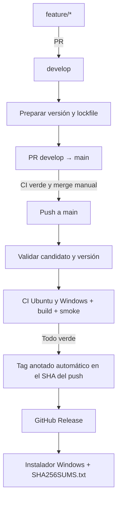

# Versionado y releases

[Índice de documentación](README.md) · [Portada](../README.md)

## Versionado

La única fuente de versión es `project.version` en
[`pyproject.toml`](../pyproject.toml). El build la lee para generar
`PyGebra-Setup-<version>.exe`. `uv.lock` refleja los metadatos y se
regenera con `uv lock`; no se edita a mano.

Usamos [Semantic Versioning](https://semver.org/lang/es/) estable `X.Y.Z`:

- **PATCH**: correcciones compatibles.
- **MINOR**: capacidades nuevas compatibles.
- **MAJOR**: cambios incompatibles importantes.

No se admiten prereleases, metadatos extra, cuatro componentes ni ceros
iniciales. Durante la etapa `0.x`, describe cualquier cambio de compatibilidad
en las notas. El incremento de 0.8.0 a 0.9.0 fue MINOR: P27 amplía
de forma compatible la experiencia (identidad PyGebra, teclado contextual,
entradas sin pérdida, pegado y edición de celdas, buscador, resultados,
escritorio, preferencias y accesibilidad) sin cambiar la matemática ni los
contratos de cálculo.

El incremento de 0.9.0 a 0.10.0 fue MINOR: incorporó las mejoras de
portapapeles matricial de P28 y fue la primera release que incluyó el
actualizador de escritorio de P29.

El incremento preparado de 0.10.0 a 0.11.0 es MINOR: añade Determinantes
(fórmula directa 2×2, Sarrus, Cofactores, LU y reducción por filas, con
procedimientos alineados con los de clase), el criterio det(A) ≠ 0 en Matriz
inversa, una factorización LU exacta sin intercambios que también admite A
rectangular, y Factorización LU y Regla de Cramer como métodos de Resolver
Ax = b. Mantiene Exacto/Decimal, los procedimientos plegables, las
confirmaciones de cálculos largos y la seguridad numérica, e incluye ajustes
de interfaz (icono del menú, temas del Inicio cerrados y selección de matrices
más compacta). Las herramientas existentes conservan sus métodos y resultados.
Una versión preparada en `develop` aún no es una release publicada.

El incremento preparado de 0.11.0 a 0.12.0 es MINOR: incorpora la
recomendación educativa de determinantes según A en el flujo A → Calcular
determinante → recomendación/elección → presupuesto → cálculo. Las
explicaciones enseñan por qué conviene Sarrus, Cofactores, LU o Reducción,
sin impedir elegir otro método disponible. Añade el menú contextual de
edición de entradas, mueve la selección matricial al clic derecho y permite
rellenar aleatoriamente matrices, vectores, escalares y números arábigos o
romanos, así como limpiar entradas conservando dimensiones y configuración.
Integra estas acciones con Deshacer y corrige el pegado de Ax = b cuando hay
una confirmación de costo pendiente. Son capacidades nuevas compatibles.

El incremento preparado de 0.12.0 a **0.12.1 es PATCH**: corrige de forma
compatible la experiencia de Determinantes introducida en 0.12.0. Simplifica
la recomendación a una explicación compacta y única antes del cálculo,
elimina la elección innecesaria en 1×1 y deja de mostrar recomendación y
selector de métodos después del cálculo. Aclara que LU en PyGebra significa
A = LU sin permutaciones: si hace falta intercambiar filas, el procedimiento
se detiene y propone otro método; no implementa PA = LU. Mantiene intactos
los algoritmos matemáticos, los procedimientos de clase, las firmas de
elección y confirmación, el presupuesto y la seguridad numérica.
Esta preparación no publica la versión: la entrega seguirá el flujo
automático tras la revisión y los merges correspondientes.

El incremento preparado de 0.12.1 a **0.13.0 es MINOR**: incorpora Métodos
numéricos con Bisección, una capacidad nueva compatible. Publica el estado
integrado en `develop` tras el PR #107, sin cambiar los algoritmos verificados.
Conjuntos queda temporalmente como «Próximamente»: su implementación y pruebas
se conservan, pero el acceso público permanece deshabilitado.

### Notas preparadas de PyGebra v0.13.0

- **Bisección:** aproxima raíces reales con procedimiento paso a paso,
  comprobaciones de dominio y explicaciones de precisión y parada.
- **Gráfica interactiva offline:** explora la función, cambia el zoom y ajusta
  los extremos sin Internet; los recursos se distribuyen con la aplicación.
- **Exploración de iteraciones:** recorre filas y deslizador sin recalcular;
  identifica los signos y la mitad conservada, y compara distintos intervalos.
- **Escritura matemática:** teclado contextual, multiplicación explícita o
  implícita, potencias con `^`, `**` o superíndices, `sen()`/`sin()`, `√()`/`sqrt()`,
  π y e. Los decimales visibles y la precisión completa cambian la lectura,
  conservando los valores y las iteraciones calculados.
- **Conjuntos:** permanece temporalmente «Próximamente», con su implementación
  conservada para una entrega posterior.

Estas notas describen un candidato, no una release publicada. Tras integrar la
preparación en `develop`, se abrirá un PR separado `develop → main` y se usará
**Create a merge commit**, conservando ambas historias. El workflow Release
creará el tag y la release únicamente después del merge a `main` y de superar
sus verificaciones.

El incremento preparado de 0.13.0 a **0.14.0 es MINOR**: incorpora Estudio,
la nueva navegación y la banda sonora opcional del PR #110, junto con las
mejoras de exploración de Bisección y del teclado compartido del PR #111.
Son capacidades compatibles: se mantienen los algoritmos y contratos de cálculo.
La preparación solo actualiza versión, lockfile y estas notas; no cambia
dependencias ni incorpora trabajo de otras ramas.

### Notas preparadas de PyGebra v0.14.0

- **Estudio:** nuevo estilo predeterminado con una habitación ilustrada,
  rincones por área y mesa de trabajo, adaptados al tema claro u oscuro.
  Opciones permite elegir Minimalista; ambos estilos comparten herramientas.
  Las animaciones respetan la preferencia de movimiento reducido y los efectos
  de sonido son opcionales, locales y apagados por defecto.
- **Nueva navegación:** Inicio organizado por áreas, explorador de herramientas,
  herramientas relacionadas y notas «Para curiosos». Atrás y Adelante usan el
  historial del navegador; las transiciones acompañan el recorrido entre Inicio,
  área y herramienta, con navegación normal cuando no están disponibles.
- **Cuatro temas musicales:** *Rincón tranquilo*, *Café de medianoche*,
  *Órbita lenta* y *Tarde de lluvia*, originales y sintetizados sin Internet.
  El reproductor ofrece elección de pieza, anterior/siguiente, pausa,
  reproducción continua y volumen independiente de los efectos. La música
  continúa al navegar, recuerda la elección y el volumen y comienza apagada
  al reabrir la aplicación.
- **Bisección:** selección de extremos desde la curva, exploración y zoom de la
  gráfica incluso sin extremos escritos, y recuperación de la vista inicial o
  del intervalo calculado. Anterior/Siguiente, deslizador y tabla comparten el
  recorrido de iteraciones sin recalcular. La verificación distingue condiciones,
  valores y conclusiones; la lectura conserva cifras distinguibles, usa el punto
  decimal y evita signos de aproximación duplicados.
- **Teclado compartido:** conserva campo, selección, superíndices y Deshacer al
  desplazar sus grupos; mejora el foco al usar la barra de desplazamiento, la
  rueda y los gestos táctiles, también en Bisección.
- **Conjuntos:** permanece como **«Próximamente»**, con el acceso público
  deshabilitado. La implementación posterior de Conjuntos P2 se desarrolla por
  separado y **no pertenece a v0.14.0**.

Estas notas describen una versión preparada, no una release publicada.
Este PR se dirige únicamente a `develop`. La promoción `develop → main`
requiere después otro PR, CI verde y autorización manual mediante
**Create a merge commit**. Solo entonces el workflow Release podrá crear el
tag y publicar el instalador y `SHA256SUMS.txt`.

El incremento preparado de 0.14.0 a **0.15.0 es MINOR**: habilita las
herramientas completas de Conjuntos del PR #113 e incorpora la optimización
de Estudio del PR #115, ambos integrados en `develop`. Son capacidades nuevas
y mejoras compatibles; se conservan los algoritmos de las demás herramientas.
La preparación actualiza únicamente versión, lockfile y estas notas, sin
cambiar dependencias.

### Notas preparadas de PyGebra v0.15.0

- **Conjuntos:** acceso público a Operaciones con conjuntos y Cardinalidad e
  inclusión-exclusión. Permite definir y editar conjuntos finitos y anidados,
  evaluar pertenencia, inclusión e igualdad, y calcular unión, intersección,
  diferencia, complemento con universo explícito y cardinalidad.
- **Potencia y producto cartesiano:** genera el conjunto potencia y productos
  de pares ordenados, con resultados exactos y procedimientos explicados.
- **Intervalos:** opera con regiones reales de extremos exactos, abiertos o
  cerrados, incluidas regiones no acotadas; presenta su recta numérica.
  Las operaciones entre conjuntos finitos no vacíos e intervalos se rechazan
  con una explicación, sin convertir unos en otros.
- **Venn y cardinalidades:** diagramas de hasta tres conjuntos, selección de
  regiones y edición de cantidades con validación de consistencia y
  procedimiento de inclusión-exclusión.
- **Estudio más ágil:** transiciones más breves y controles de navegación,
  opciones y contenido interactivos durante el viaje. El ambiente se pausa al
  bajar al catálogo y se mantiene el respeto por el movimiento reducido.
- **Audio:** separa la apertura del dispositivo de la preparación de muestras
  y cancela la preparación pendiente al pausar u ocultar la ventana, reduciendo
  el bloqueo inicial sin cambiar las piezas ni las preferencias del reproductor.

Estas notas describen una versión preparada, no una release publicada.
Este PR se dirige únicamente a `develop`; la promoción a `main`, el tag y la
publicación quedan pendientes de una revisión posterior y de su PR separado.

## Preparación de v0.16.0

Incremento **MINOR** desde 0.15.0: añade Regla Falsa clásica y la edición de
conjuntos por regiones, conservando las operaciones y los formatos existentes.
Esta versión se prepara para revisión; todavía no está publicada.

- **Regla Falsa:** vista previa de la función, secante y corte con el eje x,
  recorrido de iteraciones, error absoluto y confirmación de cercanía de la raíz.
  La lectura separa aproximación, signos, actualización, error y decisión; la
  tabla presenta a, b y xr antes de sus evaluaciones. Bisección conserva su método.
- **Conjuntos:** ejemplos en el menú Edición (también clic derecho y Shift+F10),
  selector compacto para insertar operaciones y ayuda de escritura plegable.
  El teclado matemático y los procedimientos didácticos siguen disponibles.
- **Venn por regiones:** entrada manual o aleatoria para dos o tres conjuntos,
  intersecciones y exterior cuando se indica universo. Aplicar genera las
  definiciones matemáticas y conserva los conjuntos ajenos a la distribución.
  Los elementos repetidos en regiones distintas se rechazan; el diagrama se
  recalcula desde las definiciones. El flujo manual y aleatorio funciona sin JS.

La revisión de `origin/main...origin/develop` partió de `main` en `f182f8c` y
`develop` en `50de61d`: solo incluía el PR #118 (Regla Falsa), fusionado el
9 de noviembre de 2026. `git merge-tree --write-tree origin/main origin/develop`
terminó sin conflictos. Los siete archivos de ajustes visuales que aún no
tenían commit en el worktree de Regla Falsa se incorporan en este PR;
sus originales y los trabajos de navegación/Estudio se conservan intactos.
No se incorporan otras funcionalidades en desarrollo. La promoción
`develop → main` requiere un PR separado tras revisar e integrar esta preparación.

## Preparación de v0.16.1

Incremento **PATCH** desde 0.16.0: corrige la experiencia de **Operaciones con
conjuntos**, que se sentía demasiado como un formulario. No cambia el motor
matemático, el parser ni los formatos de resultado; no añade dependencias.
Se prepara desde `develop` en `9ebeaea`, cuyo contenido es idéntico a la etiqueta
`v0.16.0`. Esta versión todavía no está publicada.

- **Barra de símbolos:** sustituye el selector «Insertar operación» y su botón.
  Conjuntos definidos, ∪ ∩ ∖ ∁ |·| ( ) × 𝒫, ∈ ∉ ⊆ ⊂ = ≠ y ∅ { } par intervalo se
  insertan en el cursor, con Deshacer nativo y navegación por flechas.
- **Venn editable:** los elementos se escriben dentro de cada región del diagrama
  (exclusivas, intersecciones y exterior). Diagrama y lista de conjuntos se
  mantienen sincronizados mediante el modelo existente; el último lado editado
  manda. El modo **Cantidades** solo maneja números y nunca inventa elementos.
- **Tarjetas de resultados:** unión, intersecciones, diferencias, diferencia
  simétrica, zonas exclusivas, complementos, cardinalidades, relaciones e
  inclusión-exclusión, con su cardinalidad, copia al portapapeles, resultados
  extensos plegados y «Ver pasos» hacia la expresión personalizada.
- **Pantalla reorganizada:** conjuntos y diagrama lado a lado, tarjetas y
  expresión personalizada con su procedimiento; ejemplos en el menú Edición.
  Estados vacíos, errores por región y foco revisados en Estudio y Minimalista.

## Flujo de integración y entrega



**Nada entra a `main` si no está listo para publicarse.** El merge a `main`
es la autorización humana de publicación. GitHub Actions crea el tag después
de CI; no hay un segundo paso manual de etiquetado.

La promoción `develop → main` se realiza mediante un PR separado, después de
integrar el incremento en `develop`. El merge conserva ambas historias.
Antes de promover, revisa la comparación y simula la integración:

```bash
git fetch origin --prune --tags
git log --left-right --graph --oneline origin/main...origin/develop
git diff origin/main...origin/develop
git merge-tree --write-tree origin/main origin/develop
```

`merge-tree` no toca las ramas ni el working tree. Revisa su código de salida
y los conflictos; una simulación limpia no sustituye CI.

## Preparar una versión

1. Desde `develop` actualizado, crea una rama, decide `project.version`, ejecuta
   `uv lock` y las [verificaciones](pruebas.md). Abre el PR hacia `develop`.
2. Después de integrarlo, abre el PR `develop → main`, espera CI verde y revisa
   la distribución. La decisión de merge inicia la publicación automáticamente.
3. Sigue la ejecución **Release** en Actions y comprueba sus assets al terminar.

No promuevas otra versión a `main` hasta que termine la publicación actual y
se resuelva cualquier fallo pendiente. No uses reset ni force-push para igualar
ramas, ni muevas tags estables existentes.

## Validación y CI

[`release.yml`](../.github/workflows/release.yml) se dispara **únicamente por
push a `main`**. Los tags son artefactos del proceso, sin trigger por tags,
`workflow_dispatch`, `pull_request` ni `workflow_run`.

[`validate_release.py`](../scripts/validate_release.py) exige:

- origen `refs/heads/main`;
- checkout en el SHA completo del evento (`github.sha`);
- `project.version` estable y derivación exacta de `v<version>`;
- versión no regresiva frente a todos los tags estables existentes, comparados
  numéricamente: `0.10.0 > 0.9.0`;
- si el tag objetivo existe, que apunte al mismo commit, resolviendo también
  tags anotados. Otro commit se rechaza inmediatamente.

Devuelve `version`, `tag` y `commit` sin modificar archivos ni refs.
Un tag del mismo commit permite reintentar; si ya hay una versión estable
posterior, el reintento también se rechaza para evitar publicar hacia atrás.

El checkout de validación y ambos checkouts de
[`ci.yml`](../.github/workflows/ci.yml) usan el SHA del evento. El workflow
reutilizable local pertenece al mismo commit; sus assets se descargan desde
esa misma ejecución. La creación del tag usa exactamente ese SHA, sin volver
a consultar el HEAD de `main`. Un avance normal de `main` durante el build
no invalida al candidato.

CI conserva todas las comprobaciones:

- Ubuntu: lockfile, entorno locked, suite completa, Django y compilación.
- Windows: [build de aplicación e instalador](../scripts/build_windows.ps1),
  suite completa y [smoke de instalación/desinstalación](../scripts/test_windows_distribution.ps1),
  con dos aperturas, accesos directos, recursos y cálculos por HTTP. Un segundo
  smoke instala la última release publicada (verificando su SHA-256) y actualiza
  encima con el candidato: sin obsoletos en `_internal`, sin accesos ni entradas
  duplicadas y con la misma identidad.

CI corre en push a `develop`, PR hacia `develop` o `main` y `workflow_call`.
Después del merge a `main`, Release lo llama una sola vez; no hay otro CI por
ese push. El CI reutilizado aísla su grupo por ejecución y no cancela una release.

## Tag, permisos y publicación

Si falla validación, tests, build o smoke, **no se crea tag ni release**.
Solo después de que CI termina correctamente, el job `publicar`:

1. Descarga el artifact de la misma ejecución.
2. Revisa de nuevo los tags remotos, rechaza regresiones y comprueba que no
   exista una release para el tag, **incluidos drafts**. Un error de API detiene
   el job. Si el tag ya existe, verifica nuevamente su commit.
3. Comprueba que el artifact contenga solo el instalador esperado y crea
   mediante la API un **tag anotado**, con mensaje `PyGebra vX.Y.Z`,
   y su ref en el SHA candidato. Un tag del mismo commit se reutiliza.
   No hay actualización de refs, force ni credenciales Git persistidas.
4. Genera `SHA256SUMS.txt` después de descargar el artifact y verifica el hash.
5. Crea un draft titulado **PyGebra vX.Y.Z**, con notas de GitHub
   (`--generate-notes`) y los dos assets.
6. Comprueba los nombres de ambos assets, los descarga del draft, compara el
   checksum y vuelve a verificar el instalador antes de publicar como `latest`.

Los permisos globales son `contents: read`; únicamente `publicar` tiene
`contents: write`. Los checkouts usan `persist-credentials: false`.
El job con escritura no hace checkout ni ejecuta scripts del repositorio o el
instalador; usa comandos del workflow. Las actions externas están fijadas a SHA.
Todo concluye en la misma ejecución, sin depender de otro workflow por el tag.

Los únicos assets públicos son:

- `PyGebra-Setup-<version>.exe`;
- `SHA256SUMS.txt`.

La carpeta PyInstaller, `build/`, logs y bootstrapper WebView2 no se publican
por separado. Los artifacts de CI son temporales; las Releases son entregas
estables. El badge estándar de la portada enlaza a la última release publicada
sin fijar la versión preparada en el README.

## Concurrencia

Release usa un grupo compartido, `cancel-in-progress: false` y `queue: max`.
La [cola de GitHub Actions](https://docs.github.com/en/actions/how-tos/write-workflows/choose-when-workflows-run/control-workflow-concurrency)
admite hasta 100 ejecuciones pendientes; a diferencia de la cola predeterminada,
una tercera promoción no sustituye silenciosamente a la segunda.

La cola sigue el orden de entrada a espera, que no garantiza el orden de los
pushes; al llenarse se cancelan las ejecuciones adicionales. Por eso se mantiene
la regla operativa de **una promoción a main a la vez**, esperando la release.
La cola evita sustituciones normales; no implementa un sistema de locking ni
impide cambios manuales de otros mantenedores en GitHub.

## Fallos y reintentos

- **Antes de crear el tag:** no quedan tag ni release nuevos. Un fallo
  transitorio permite reejecutar el workflow desde Actions para el mismo SHA.
- **Después del tag y antes del draft:** se puede reejecutar para el mismo
  commit. Se repite CI y se reutiliza el tag solo si sigue apuntando a ese SHA
  y no existe una versión posterior.
- **Si existe una release o draft:** el workflow se detiene. Revisa manualmente
  un draft parcial antes de completarlo o eliminar ese borrador fallido y
  reintentar. No se sobrescribe ni se usa `--clobber`.
- **Si la release ya se publicó:** un reintento no la reemplaza. Una corrección
  requiere otra versión preparada y promovida por PR.

Nunca muevas un tag estable ni borres una release publicada para ocultar una
corrección. Una modificación del código requiere un nuevo commit y una versión
apropiada; el reintento del mismo SHA reconstruye el mismo candidato.

## Validar sin publicar

```bash
uv run --locked python -m unittest tests.test_release tests.test_documentacion -v
```

Las pruebas crean repositorios temporales y comprueban el candidato y los
contratos de los workflows, sin crear tags en este repositorio. El validador
también admite `--ref refs/heads/main --sha <SHA-del-evento>` desde un checkout
de ese commit con los tags actualizados; solo lee. Completa la suite, CI, build
y smoke normales, sin crear tags remotos o releases de prueba.

## Verificar una descarga

Descarga ambos assets de la misma release. En PowerShell:

```powershell
Get-FileHash .\PyGebra-Setup-*.exe -Algorithm SHA256
Get-Content .\SHA256SUMS.txt
```

Compara el hash y el nombre. En Linux, desde la carpeta de descarga:

```bash
sha256sum --check SHA256SUMS.txt
```

El checksum detecta diferencias con el archivo publicado. No es una firma
digital; Windows puede mostrar un editor desconocido.

La app de escritorio hace esta misma comprobación al actualizarse
(**Menú → Actualizaciones**): consume solo releases estables, descarga
`PyGebra-Setup-<versión>.exe` y `SHA256SUMS.txt` de la misma release y no ejecuta
el instalador si el SHA-256 no coincide. Por eso cada release debe seguir
publicando exactamente esos dos assets con esos nombres.
