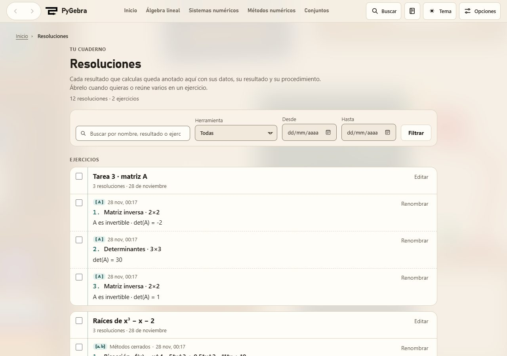
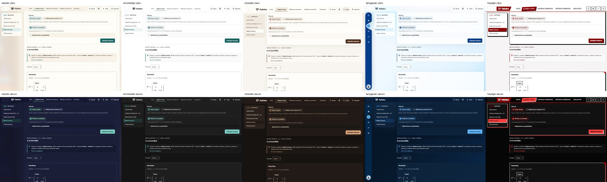
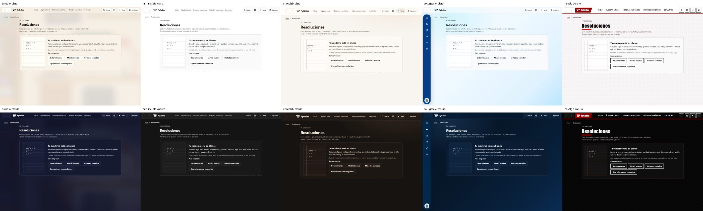
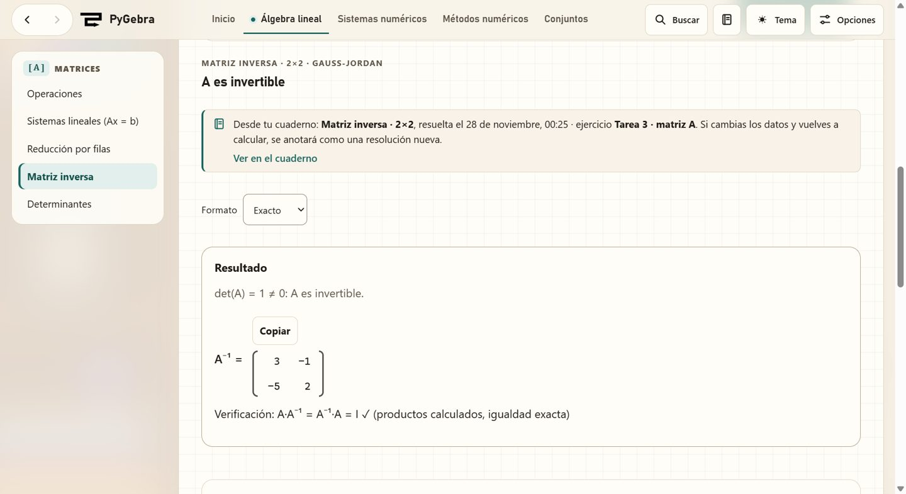

# Cuaderno de resoluciones

[Índice de documentación](README.md) · [Arquitectura](arquitectura.md)

Cada resolución válida de la interfaz visual se anota sola en un cuaderno local. Desde
**Resoluciones** (cabecera) se consulta, se busca por nombre, resultado o ejercicio,
se filtra por herramienta y fecha, se renombra, se elimina y se reúne en ejercicios.
Abrir una resolución lleva a su herramienta con los datos, el resultado y el
procedimiento originales, sin volver a calcular.



## Uso

- **Guardar.** Al calcular, el aviso del resultado dice cómo quedó anotada la
  resolución («Matriz inversa · 2×2») y permite añadirla a un ejercicio.
- **Sin duplicados.** Recargar, volver atrás o calcular lo mismo otra vez no crea una
  segunda resolución: el aviso dice «Ya estaba en tu cuaderno».
- **Ejercicios.** Un ejercicio es una hoja con pasos numerados (por ejemplo, un
  determinante, la inversa y su comprobación). Cada resolución conserva su resultado.
  Las que no pertenecen a ninguno quedan en **Sueltas**, agrupadas por día.
- **Selección.** Las casillas, «marcar el ejercicio o el día» y la barra *Reunir en ·
  Sacar del ejercicio · Eliminar…* trabajan sobre la misma selección, que usará la
  exportación a PDF. Eliminar siempre pide confirmación.
- **Reabrir.** Si cambias los datos de una resolución reabierta y calculas, se anota
  una resolución nueva; la original no se sobrescribe.
- Todo funciona sin JavaScript; `resoluciones.js` añade el recuento, marcar un grupo
  y la barra flotante.

## Dónde se guarda

| Situación | Archivo |
| --- | --- |
| App de escritorio | `%LOCALAPPDATA%\PyGebra\resoluciones.sqlite3` |
| Navegador de desarrollo (`manage.py runserver`) | `%LOCALAPPDATA%\PyGebra\resoluciones-desarrollo.sqlite3` |
| `ALGEBRA_RESOLUCIONES` definida | La ruta indicada (worktrees, diagnóstico) |
| Suite y runners de navegador | Un temporal propio (`tests/__init__.py`) |

Fuera de Windows, la carpeta es `~/.local/share/PyGebra`. WebView2 sigue en modo
privado: el cuaderno no depende de su perfil, lo escribe Django.

## Arquitectura

```text
POST herramienta → vista (sin cambios) → TemplateResponse(contexto)
                   └─ ResolucionesMiddleware.process_template_response
                        └─ servicio.guardar → contrato.documento → almacen.guardar
GET herramienta?resolucion=<id>
                   └─ la vista arma su página vacía (no calcula)
                   └─ servicio.reabrir: formulario y resultado guardados en el mismo contexto
/resoluciones/     └─ views_resoluciones: lista, filtros y acciones (solo metadatos)
```

| Módulo (`frontend/web/calculadora/resoluciones/`) | Responsabilidad |
| --- | --- |
| `contrato.py` | Documento versionado, codificación exacta, huella y validación al leer. |
| `almacen.py` | SQLite (biblioteca estándar): tablas, transacciones, límites y recuperación. |
| `registro.py` | Un `Adaptador` por herramienta: qué guardar y cómo reabrir. |
| `servicio.py` | Guardar un contexto válido y prepararlo para reabrir. |
| `middleware.py` | Enlaza lo anterior con las vistas sin modificarlas. |

Ninguna vista, motor ni formulario de herramienta cambió. La plantilla común
`layouts/herramienta.html` incluye `components/resolucion_aviso.html`.

## Contrato `pygebra.resolucion` v1

```json
{"contrato": "pygebra.resolucion", "version": 1, "app": "0.20.3",
 "creado": "2026-11-28T00:17:41-06:00",
 "herramienta": {"id": "matriz-inversa", "nombre": "Matriz inversa", "ruta": "matriz-inversa", "esquema": 1},
 "entrada": {"orden": ["2"], "celda_A_0_0": ["2"], "metodo": ["gauss_jordan"]},
 "resultado": {"resultado": {"invertible": true, "determinante": "1", "inversa": [["3", "-1"], ["-5", "2"]], "pasos": []}},
 "resumen": "A es invertible · det(A) = 1",
 "grafica": null}
```

- **`entrada`**: los campos tal como se enviaron, sin el token CSRF.
- **`resultado`**: los datos que el servicio de la herramienta calculó, por clave de
  contexto. Son datos, no HTML: matrices, pasos, tablas, clasificaciones y textos.
  Los racionales llegan como cadenas exactas (`formatear_exacto`) y los floats con
  todas sus cifras (`repr`).
- **Etiquetas de tipo**: `$fraccion`, `$decimal`, `$real` (±∞, NaN), `$conjunto` y
  `$dict` (claves no textuales). `contrato.decodificar` las restaura.
- **`grafica`**: lo que la página pide aparte. En raíces: función, encuadre inicial y
  sus 801 muestras; el recorrido de iteraciones ya está en `resultado`.
- **`esquema`**: versión de la forma de `resultado` en esa herramienta.
- **Huella** (columna única): SHA-256 de herramienta + esquema + entrada sin token,
  firmas (`confirmacion`, `eleccion`), botones ni controles de presentación
  (`Adaptador.ignorar`, p. ej. los bloques visibles de Reducción por filas).

Una huella repetida nunca reemplaza el documento: solo actualiza la fecha de uso.

## Robustez y recuperación

| Situación | Comportamiento |
| --- | --- |
| Bloqueo de otra ventana, permisos o disco | `AlmacenNoDisponible`. El resultado se muestra igual con «no se guardó»; el archivo no se toca. |
| Archivo que no es SQLite, `SQLITE_CORRUPT`/`SQLITE_NOTADB` o `quick_check` ≠ ok | Se renombra a `resoluciones.apartado-AAAAMMDD-HHMMSS.sqlite3` (con sus diarios), se crea uno nuevo y el cuaderno lo informa. Si no se puede renombrar, no se toca. |
| Fila con JSON inválido o de otro contrato | Se lista como «No se puede abrir» y se puede eliminar. |
| Documento de una versión más reciente | Se conserva intacto; esta versión no lo interpreta. |
| Base con `user_version` mayor | No se modifica (`AlmacenFuturo`). |
| `esquema` distinto del actual | Se abre con sus datos en el formulario y sin resultado; calcular es decisión del usuario. |
| La plantilla no puede mostrar un documento | Se muestra la página sin resultado y el aviso de registro dañado. |

Límites: 4 MB por documento y 256 MB por cuaderno. Al superarlos no se guarda y se
avisa; nada se borra automáticamente.

La consola aplica la misma regla a su historial (`frontend/terminal/historial.py`):
un ejercicio ilegible se omite, se conservan los demás y los ajustes, y se avisa
cuántos se omitieron. Antes, uno solo hacía perder todo el historial de la sesión.

## Incorporar una herramienta

Añadir su entrada a `registro.ADAPTADORES` (clave: nombre de la ruta Django) y su caso
a `CASOS` en `tests/test_resoluciones.py`; la prueba exige que el HTML reabierto sea
idéntico al original.

```python
"nombre-de-ruta": Adaptador(
    ("resultado",),                       # claves del contexto que forman el resultado
    resumen=lambda c: c["resultado"]["…"],  # una línea para el cuaderno
),
```

Si una herramienta cambia la forma de esas claves, sube su `esquema`.

### Operaciones con matrices y expresiones múltiples

Operaciones queda fuera hasta que se integre el PR de expresiones múltiples. Con su
vista nueva (`resultados` por fila, `resultado` cuando hay una sola y `hay_resultados`):

1. Añadir `"operaciones-matrices": Adaptador(("resultados", "resultado", "hay_resultados"),
   principal="hay_resultados", …)`.
2. Si un lote con filas erróneas debe guardarse, sustituir `es_valida` por un predicado
   que acepte errores por fila; hoy un formulario con errores no se guarda.
3. Guardar en cada fila solo datos de presentación: el contrato rechaza objetos como
   los nodos del AST (`NoCodificable`) y entonces la resolución no se anota.
4. `formulario` por defecto reconstruye `ExpresionMatricialForm(datos)`; si su
   constructor exige más argumentos, dar una fábrica propia.
5. Añadir el caso a `CASOS` con dos o más expresiones.

## Exportación a PDF (futura)

El PDF debe leer los documentos con `almacen().obtener(id)` y `contrato.leer`/`decodificar`,
y los ejercicios con `almacen().ejercicios()` y el orden de `creado`. Con `entrada`,
`resultado`, `resumen` y `grafica` tiene la matemática exacta y las muestras de las
gráficas, así que puede tener su propio diseño: no necesita capturas, ni el DOM, ni
las plantillas visuales, ni recalcular. La selección del cuaderno (`ids`) es la que
recibirá.

## Verificación

- `tests/test_resoluciones.py`: contrato, almacén (persistencia, duplicados, límites,
  fila y archivo dañados, bloqueo temporal, base futura), las 13 rutas registradas
  guardadas una vez y reabiertas idénticas, sin recálculo, agrupar, buscar, filtrar,
  renombrar, eliminar con confirmación y consola.
- `tests/resoluciones_browser.py`/`.js` (en la selección de CI): aviso, agrupar desde la
  herramienta, reabrir, selección, renombrar con Enter, eliminar, flujo sin JavaScript,
  los cinco estilos en claro y oscuro y móvil.
- WebView2 real (`desktop.py`, CDP): calcular, agrupar, cerrar la app, reabrirla,
  recuperar la resolución y recalcular sin duplicar.









## Limitaciones conocidas

- Operaciones con matrices todavía no se anota (ver arriba).
- Si el contexto de una herramienta trae un objeto que no es dato, la resolución no se
  anota y el aviso lo dice; las 13 rutas registradas están cubiertas por las pruebas.
- Las muestras de la gráfica de raíces son las del encuadre inicial. Acercar o mover la
  gráfica vuelve a muestrear la función guardada: es exploración, no el resultado.
- Los pasos de un ejercicio siguen el orden en que se calcularon; no se reordenan a mano.
- «Comparar ambos» de Reducción por filas es una sola resolución con los dos métodos.
- La búsqueda filtra los metadatos en Python: sencilla y suficiente con el límite de
  256 MB; si el cuaderno creciera mucho, convendría un índice en SQLite.
- En móvil, los filtros ocupan su propio bloque antes de la lista.
