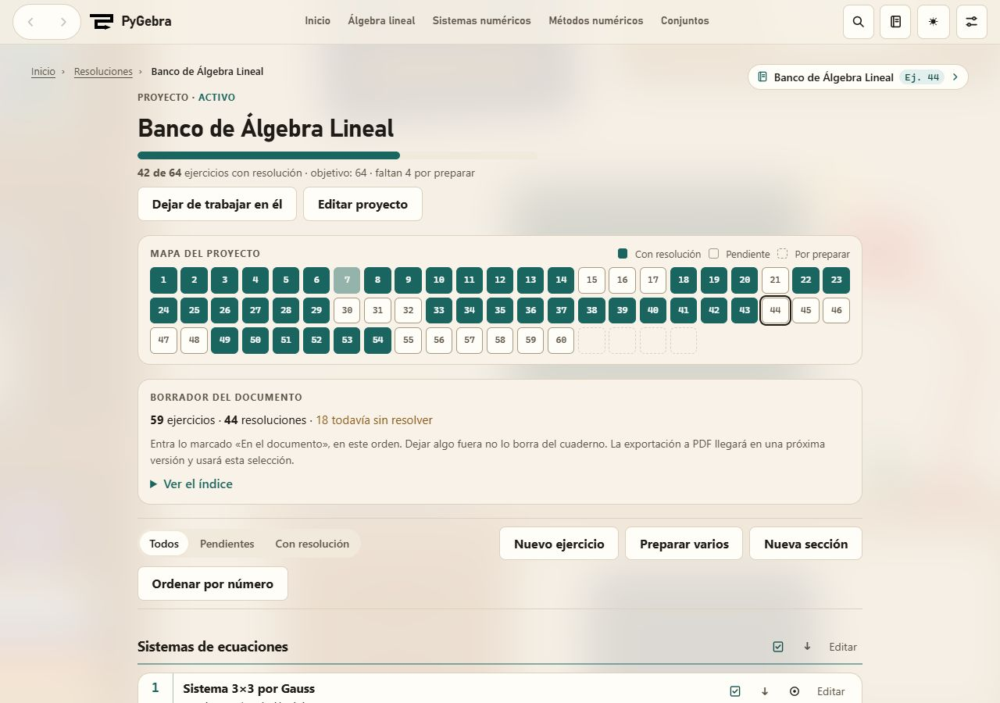
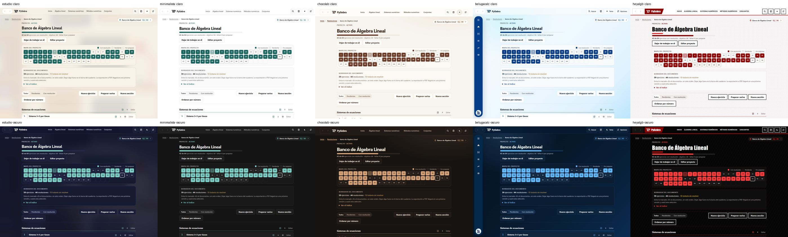
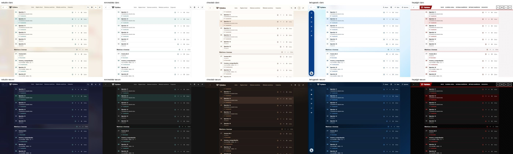
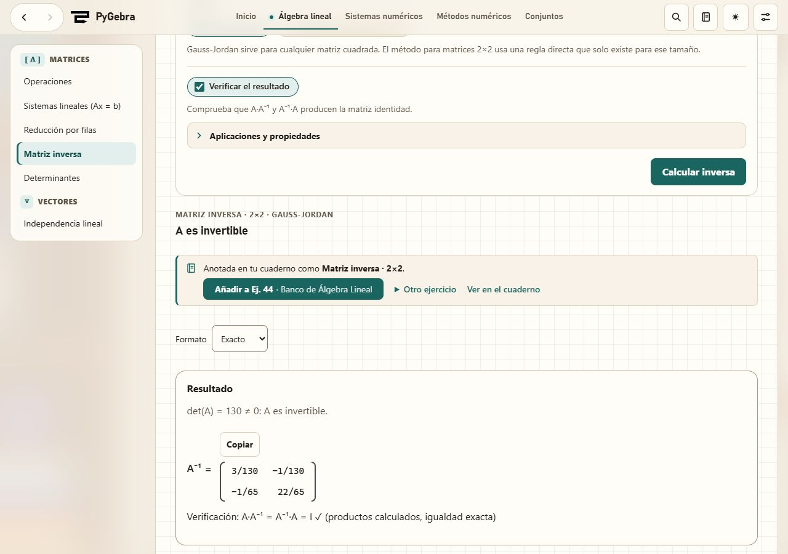
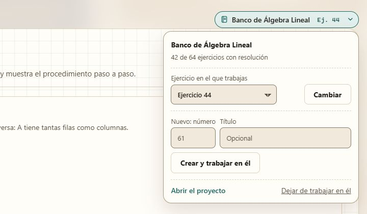
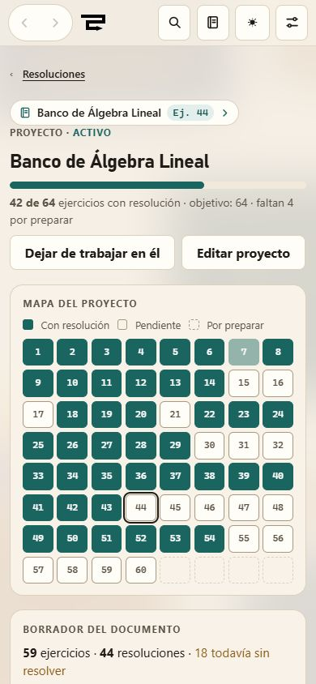
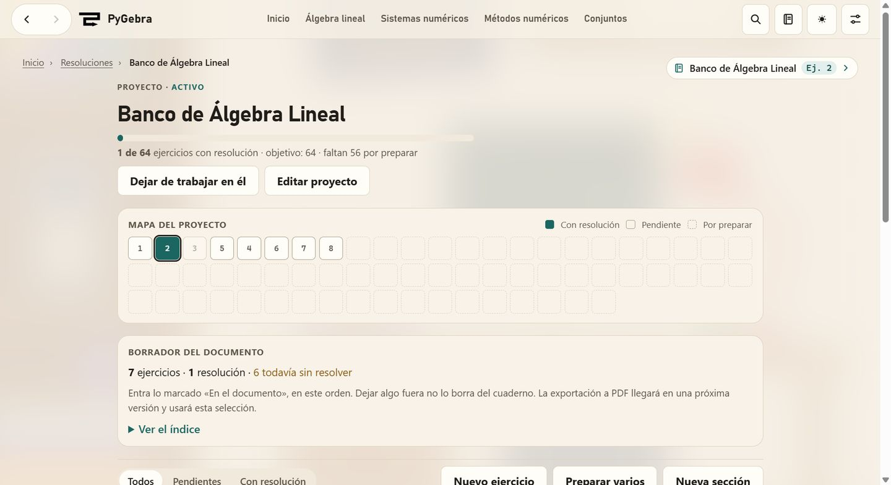
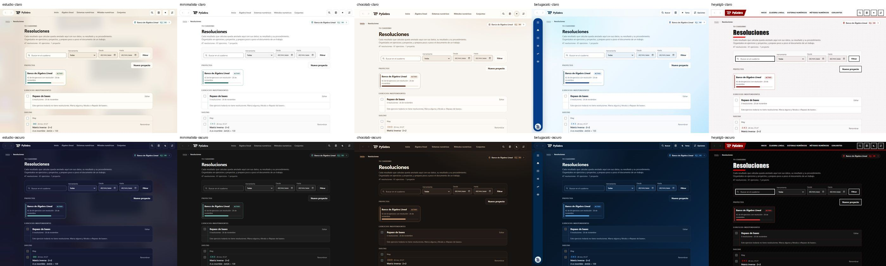
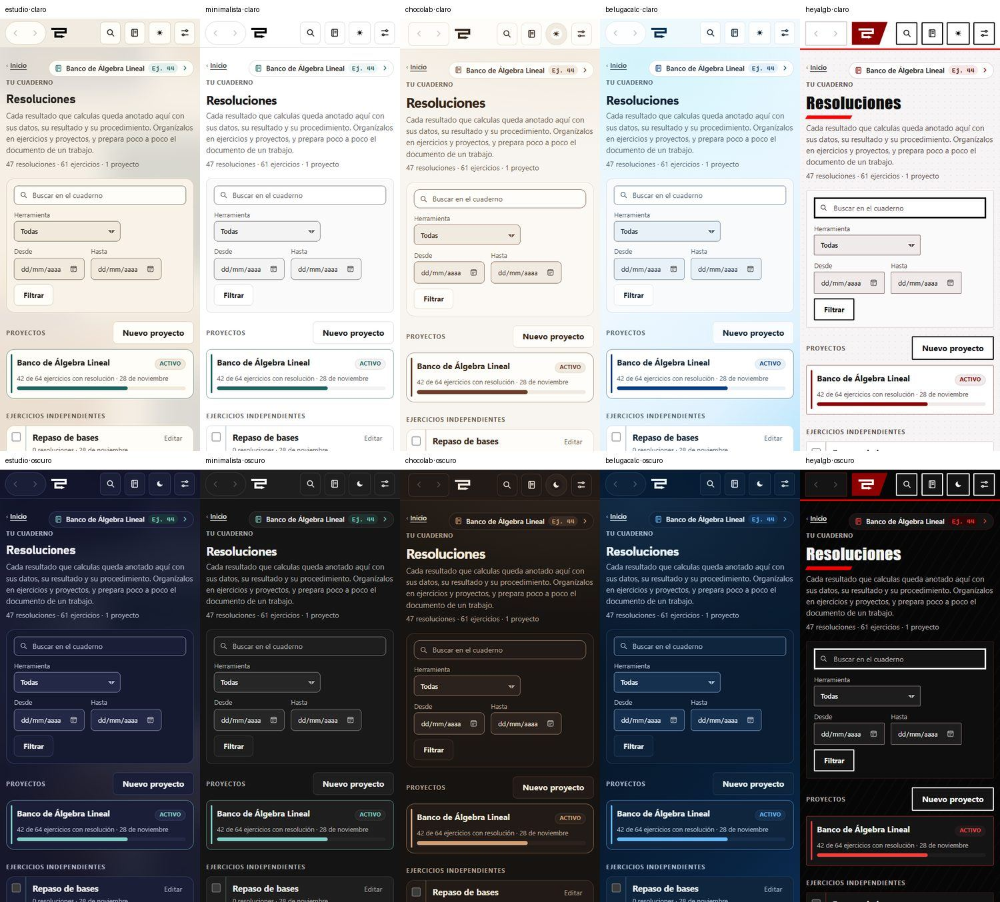

# Cuaderno de resoluciones

[Índice de documentación](README.md) · [Arquitectura](arquitectura.md)

Cada resolución válida de la interfaz visual se anota sola en un cuaderno local. Desde
**Resoluciones** (cabecera) se consulta, se busca por nombre, resultado, ejercicio o
proyecto, se filtra por herramienta y fecha, se renombra, se elimina y se organiza en
**Proyecto → Ejercicio → Resoluciones**. Abrir una resolución lleva a su herramienta con
los datos, el resultado y el procedimiento originales, sin volver a calcular.



## Uso

- **Guardar.** Al calcular, el aviso del resultado dice cómo quedó anotada la
  resolución («Matriz inversa · 2×2») y permite añadirla a un ejercicio.
- **Sin duplicados.** Recargar, volver atrás o calcular lo mismo otra vez no crea una
  segunda resolución: el aviso dice «Ya estaba en tu cuaderno».
- **Ejercicios.** Un ejercicio reúne resoluciones (por ejemplo, un determinante, la
  inversa y su comprobación); cada una conserva su resultado. Puede tener número, título
  y enunciado, pertenecer a un proyecto o ser independiente. Las resoluciones que no
  pertenecen a ninguno quedan en **Sueltas**, agrupadas por día.
- **Selección.** Las casillas, «marcar el ejercicio o el día» y la barra *Llevar a ·
  Sacar del ejercicio · Eliminar…* trabajan sobre la misma selección. Eliminar siempre
  pide confirmación.
- **Reabrir.** Si cambias los datos de una resolución reabierta y calculas, se anota
  una resolución nueva; la original no se sobrescribe.
- Todo funciona sin JavaScript; `resoluciones.js` añade el recuento, marcar un grupo
  y la barra flotante.
- **Cabecera.** Resoluciones usa las clases de Buscar y muestra su nombre desde 1600 px.
  Hasta 640 px y mientras las áreas están en la cabecera con poco espacio (1180–1439 px;
  BelugaCalc las lleva en su riel), Buscar, Tema y Opciones también quedan en icono, como
  ya hacía HeyAlgb, cuyas pestañas se compactan en ese tramo. Con fuentes más anchas que
  Segoe UI (Linux, zoom) las áreas o la marca quedaban debajo de los botones; el runner
  `resoluciones` lo comprueba de 481 a 1600 px en los cinco estilos.

## Proyectos

Un proyecto es un trabajo que se construye poco a poco (por ejemplo, un banco de 64
ejercicios) y el borrador persistente de su documento.

- **Crear y preparar.** *Nuevo proyecto* (nombre y ejercicios previstos) lo crea y lo deja
  activo. *Preparar varios* crea ejercicios numerados de una vez (del 1 al 64, sin repetir
  números) y *Nuevo ejercicio* uno con número, título, enunciado y sección. Los ejercicios
  pueden existir antes de tener resoluciones.
- **Proyecto activo.** Junto a las migas de cualquier página, un indicador discreto dice
  en qué proyecto y ejercicio se trabaja; desde él se cambia de ejercicio, se crea uno
  nuevo o se deja el proyecto. Tras calcular, el aviso ofrece **Añadir a Ej. N** (un clic)
  u **Otro ejercicio**. *Trabajar aquí* (icono de diana) activa un ejercicio desde el
  proyecto. El estado activo se guarda en el cuaderno, no en el navegador: sobrevive al
  cierre de la app.
- **Orden.** Flechas para subir o bajar ejercicios, secciones y resoluciones; *Ordenar por
  número* aplica un orden natural (2 < 10, 3a < 3b, 4.1 < 4.10). Las secciones son
  opcionales y agrupan ejercicios dentro del proyecto.
- **Mover y quitar sin perder nada.** *Editar → Ubicación* lleva un ejercicio a otra
  sección, a otro proyecto o fuera de todos (independiente). Quitar una sección deja sus
  ejercicios en el proyecto; eliminar un proyecto deja sus ejercicios como independientes,
  con sus resoluciones; *Desagrupar* deja las resoluciones sueltas.
- **Borrador del documento.** Cada sección, ejercicio y resolución tiene su interruptor
  *En el documento*: lo habitual (dentro) es un icono discreto y lo excepcional (fuera) se
  lee entero. El panel *Borrador del documento* cuenta lo que entraría y muestra el
  índice. Excluir nunca borra.
- **Orientarse en proyectos largos.** La barra de progreso cuenta los ejercicios con
  resolución sobre el objetivo; el **mapa** dibuja una casilla por ejercicio en el orden
  del documento (rellena = con resolución, punteada = por preparar, atenuada = fuera del
  documento) y enlaza a cada uno. Las vistas *Todos · Pendientes · Con resolución*
  filtran la lista. Cada sección es una sola hoja con un renglón por ejercicio y su
  respuesta principal; las resoluciones se despliegan (abiertas en el ejercicio activo).

## Dónde se guarda

| Situación | Archivo |
| --- | --- |
| App de escritorio | `%LOCALAPPDATA%\PyGebra\resoluciones.sqlite3` |
| Navegador de desarrollo (`manage.py runserver`) | `%LOCALAPPDATA%\PyGebra\resoluciones-desarrollo.sqlite3` |
| `ALGEBRA_RESOLUCIONES` definida | La ruta indicada (worktrees, diagnóstico) |
| Suite y runners de navegador | Un temporal propio (`tests/__init__.py`) |

Fuera de Windows, la carpeta es `~/.local/share/PyGebra`. WebView2 sigue en modo
privado: el cuaderno no depende de su perfil, lo escribe Django.

## Arquitectura

```text
POST herramienta → vista (sin cambios) → TemplateResponse(contexto)
                   └─ ResolucionesMiddleware.process_template_response
                        └─ servicio.guardar → contrato.documento → almacen.guardar
GET herramienta?resolucion=<id>
                   └─ la vista arma su página vacía (no calcula)
                   └─ servicio.reabrir: formulario y resultado guardados en el mismo contexto
/resoluciones/     └─ views_resoluciones: lista, filtros y acciones (solo metadatos)
```

| Módulo (`frontend/web/calculadora/resoluciones/`) | Responsabilidad |
| --- | --- |
| `contrato.py` | Documento versionado, codificación exacta, huella y validación al leer. |
| `almacen.py` | SQLite (biblioteca estándar): tablas, migraciones, orden, selección, límites y recuperación. |
| `organizacion.py` | Proyectos listos para mostrar o exportar: árbol, progreso, mapa, borrador y proyecto activo. |
| `registro.py` | Un `Adaptador` por herramienta: qué guardar y cómo reabrir. |
| `servicio.py` | Guardar un contexto válido y prepararlo para reabrir. |
| `middleware.py` | Enlaza lo anterior con las vistas sin modificarlas. |

Ninguna vista, motor ni formulario de herramienta cambió. La plantilla común
`layouts/herramienta.html` incluye `components/resolucion_aviso.html`; `base.html`
incluye `components/proyecto_activo.html` junto a las migas (context processor
`proyecto_activo`, una sola consulta por página).

### Base de datos (versión 2)

```text
proyectos(id, nombre, objetivo, creado)
secciones(id, proyecto → proyectos ON DELETE CASCADE, titulo, posicion, incluir)
ejercicios(id, nombre, numero, enunciado, proyecto → SET NULL, seccion → SET NULL, posicion, incluir, creado)
resoluciones(id, huella UNIQUE, ruta, herramienta, nombre, ejercicio → SET NULL, posicion, incluir, creado, usado, documento)
ajustes(clave, valor)        -- activo_proyecto, activo_ejercicio
```

Las migraciones (`almacen.MIGRACIONES`) se aplican en orden, cada una en su
transacción (`BEGIN … PRAGMA user_version … COMMIT`): si una falla, el cuaderno queda
en su versión anterior, intacto. Antes de migrar un cuaderno con datos se copia completo
a `resoluciones.v<N>-respaldo.sqlite3` (API de respaldo de SQLite). La v2 solo añade
tablas y columnas; las resoluciones y ejercicios v1 quedan independientes, en su orden.
El contrato de los documentos no cambia (sigue en v1): la organización vive en las
tablas, no dentro de cada resolución.

## Contrato `pygebra.resolucion` v1

```json
{"contrato": "pygebra.resolucion", "version": 1, "app": "0.20.3",
 "creado": "2026-11-28T00:17:41-06:00",
 "herramienta": {"id": "matriz-inversa", "nombre": "Matriz inversa", "ruta": "matriz-inversa", "esquema": 1},
 "entrada": {"orden": ["2"], "celda_A_0_0": ["2"], "metodo": ["gauss_jordan"]},
 "resultado": {"resultado": {"invertible": true, "determinante": "1", "inversa": [["3", "-1"], ["-5", "2"]], "pasos": []}},
 "resumen": "A es invertible · det(A) = 1",
 "grafica": null}
```

- **`entrada`**: los campos tal como se enviaron, sin el token CSRF.
- **`resultado`**: los datos que el servicio de la herramienta calculó, por clave de
  contexto. Son datos, no HTML: matrices, pasos, tablas, clasificaciones y textos.
  Los racionales llegan como cadenas exactas (`formatear_exacto`) y los floats con
  todas sus cifras (`repr`).
- **Etiquetas de tipo**: `$fraccion`, `$decimal`, `$real` (±∞, NaN), `$conjunto` y
  `$dict` (claves no textuales). `contrato.decodificar` las restaura.
- **`grafica`**: lo que la página pide aparte. En raíces: función, encuadre inicial y
  sus 801 muestras; el recorrido de iteraciones ya está en `resultado`.
- **`esquema`**: versión de la forma de `resultado` en esa herramienta.
- **Huella** (columna única): SHA-256 de herramienta + esquema + entrada sin token,
  firmas (`confirmacion`, `eleccion`), botones ni controles de presentación
  (`Adaptador.ignorar`, p. ej. los bloques visibles de Reducción por filas).

Una huella repetida nunca reemplaza el documento: solo actualiza la fecha de uso.

## Robustez y recuperación

| Situación | Comportamiento |
| --- | --- |
| Bloqueo de otra ventana, permisos o disco | `AlmacenNoDisponible`. El resultado se muestra igual con «no se guardó»; el archivo no se toca. |
| Archivo que no es SQLite, `SQLITE_CORRUPT`/`SQLITE_NOTADB` o `quick_check` ≠ ok | Se renombra a `resoluciones.apartado-AAAAMMDD-HHMMSS.sqlite3` (con sus diarios), se crea uno nuevo y el cuaderno lo informa. Si no se puede renombrar, no se toca. |
| Fila con JSON inválido o de otro contrato | Se lista como «No se puede abrir» y se puede eliminar. |
| Documento de una versión más reciente | Se conserva intacto; esta versión no lo interpreta. |
| Base con `user_version` mayor | No se modifica (`AlmacenFuturo`). |
| `esquema` distinto del actual | Se abre con sus datos en el formulario y sin resultado; calcular es decisión del usuario. |
| La plantilla no puede mostrar un documento | Se muestra la página sin resultado y el aviso de registro dañado. |

Límites: 4 MB por documento y 256 MB por cuaderno. Al superarlos no se guarda y se
avisa; nada se borra automáticamente.

La consola aplica la misma regla a su historial (`frontend/terminal/historial.py`):
un ejercicio ilegible se omite, se conservan los demás y los ajustes, y se avisa
cuántos se omitieron. Antes, uno solo hacía perder todo el historial de la sesión.

## Incorporar una herramienta

Añadir su entrada a `registro.ADAPTADORES` (clave: nombre de la ruta Django) y su caso
a `CASOS` en `tests/test_resoluciones.py`; la prueba exige que el HTML reabierto sea
idéntico al original.

```python
"nombre-de-ruta": Adaptador(
    ("resultado",),                       # claves del contexto que forman el resultado
    resumen=lambda c: c["resultado"]["…"],  # una línea para el cuaderno
),
```

Si una herramienta cambia la forma de esas claves, sube su `esquema`.

### Operaciones con matrices (expresiones múltiples) e Independencia lineal

Ambas están registradas desde la integración de los PR #164 y #166, sin tocar sus
vistas, formularios ni motores:

- **Operaciones**: guarda `resultados` (una fila por expresión con su resultado
  estructurado o su error), `resultado` y `hay_resultados`. `errores_parciales=True`
  permite anotar un lote con filas erróneas; `preparar` quita de cada fila el nodo del
  AST, que no es un dato, y `formulario` repone al reabrir los errores de evaluación que
  la vista añadió junto a cada campo. El nombre indica cuántas expresiones acompañan a la
  primera («Operaciones · A + B (+2)»).
- **Independencia lineal**: guarda su `resultado` de presentación (planteamiento,
  matrices, pasos, rango, relación de dependencia). La clave `resolucion` de su contexto
  es del backend; por eso el aviso del cuaderno usa `resolucion_cuaderno`.

Sus casos en `CASOS` (con un error parcial en Operaciones) exigen el mismo HTML al reabrir.

## Exportación a PDF (futura)

Un proyecto ya es el borrador del documento. El exportador recorrerá
`organizacion.arbol(proyecto, ejercicios, secciones, resoluciones, solo_incluidos=True)`
(secciones → ejercicios con número, título y enunciado → resoluciones, en el orden y con
la selección guardados) y leerá cada documento con `almacen().obtener(id)` y
`contrato.leer`/`decodificar`. Con `entrada`, `resultado`, `resumen` y `grafica` tiene la
matemática exacta y las muestras de las gráficas, así que podrá tener su propio diseño:
no necesita capturas, ni el DOM, ni las plantillas visuales, ni recalcular. Para un PDF
fuera de proyectos, la selección del cuaderno (`ids`) sirve igual.

## Verificación

- `tests/test_resoluciones.py`: contrato, almacén (persistencia, duplicados, límites,
  fila y archivo dañados, bloqueo temporal, base futura), migración v1 → v2 (datos y
  respaldo) y migración fallida sin efectos, las 15 rutas registradas guardadas una vez y
  reabiertas idénticas (con errores parciales de expresiones múltiples), sin recálculo,
  proyectos (crear y activar, preparar 1–64, numeración y orden natural, secciones,
  mover entre proyectos, eliminar sin perder resoluciones), proyecto activo y añadir con
  un clic, borrador persistente tras reiniciar, resoluciones de todos los módulos en un
  proyecto, un proyecto de 64 ejercicios en menos de 3 s, `volver` solo a rutas locales,
  buscar, filtrar, renombrar, eliminar con confirmación y consola.
- `tests/resoluciones_browser.py`/`.js` (en la selección de CI): aviso, agrupar desde la
  herramienta, reabrir, selección, renombrar con Enter, eliminar, flujo sin JavaScript,
  proyecto completo (crear, preparar, trabajar aquí, calcular, añadir con un clic,
  cambiar de ejercicio desde el indicador), excluir y reordenar, los cinco estilos en
  claro y oscuro con proyecto activo, cabecera de 481 a 1600 px y móvil.
- WebView2 real (`desktop.py`, CDP): calcular, agrupar, cerrar la app, reabrirla,
  recuperar la resolución y recalcular sin duplicar; y con proyectos: crear, preparar,
  trabajar en un ejercicio, añadir, excluir y reordenar, reiniciar y encontrar el
  proyecto activo, el orden, la exclusión y la resolución intactos.



















## Limitaciones conocidas

- Si el contexto de una herramienta trae un objeto que no es dato, la resolución no se
  anota y el aviso lo dice; las 15 rutas registradas están cubiertas por las pruebas.
- Reordenar es con flechas (y *Ordenar por número*), sin arrastrar. Un solo proyecto
  activo a la vez.
- *Preparar varios* crea hasta 200 ejercicios de una vez.
- Las muestras de la gráfica de raíces son las del encuadre inicial. Acercar o mover la
  gráfica vuelve a muestrear la función guardada: es exploración, no el resultado.
- «Comparar ambos» de Reducción por filas es una sola resolución con los dos métodos.
- La búsqueda filtra los metadatos en Python: sencilla y suficiente con el límite de
  256 MB; si el cuaderno creciera mucho, convendría un índice en SQLite.
- En móvil, los filtros ocupan su propio bloque antes de la lista.
