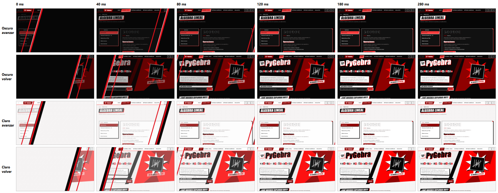

# Temas homenaje

PyGebra incluye tres estilos en honor a los proyectos hermanos del curso:
**ChocoLab**, **BelugaCalc** y **HeyAlgb**. Se eligen en **Opciones → Apariencia**,
junto a Estudio y Minimalista, y cada uno tiene variante clara y oscura con
personalidad propia.

La idea: al activar uno, por un momento parece que se usa otra calculadora, pero la
aplicación sigue siendo PyGebra. Cambian la atmósfera, la composición de Inicio, la
presentación del catálogo, la navegación, las cabeceras y el movimiento. Se conservan
el símbolo y el nombre de PyGebra, el motor matemático, el catálogo de herramientas,
los formularios, el teclado matemático y la lectura de resultados.

## Cómo están hechos

| Pieza | Archivo | Qué hace |
|---|---|---|
| Valores del estilo | `preferencias.py`, `tema_inicial.html` | `pygebra-estilo` admite `chocolab`, `belugacalc` y `heyalgb`. `preferencias.estilo()` valida la misma lista antes del primer pintado y `opciones.js` la reutiliza al volver del historial. |
| Tokens y piezas comunes | `styles/homenajes.css` | Colores claro/oscuro de cada tema sobre los tokens de `tokens.css`, los logotipos de Opciones y el gesto de cambio de estilo. |
| Composición y movimiento | `styles/homenaje-chocolab.css`, `homenaje-belugacalc.css`, `homenaje-heyalgb.css` | Portada, catálogo, navegación, cabecera, área, mesa de trabajo y animaciones de cada tema. |
| Navegación por áreas | `components/nav_areas.html` | La navegación global de PyGebra, compartida por los cinco estilos y sacada del catálogo: enlaces sobrios en Estudio y Minimalista, pastillas en ChocoLab, riel lateral en BelugaCalc y pestañas angulares en HeyAlgb. `context_processors.navegacion` aporta `en_inicio`, `area_actual_id` e `indice_area`. Ver [Shell y navegación](interfaz.md#shell-y-navegación). |
| Portadas | `components/homenaje_portada.html` | Ilustración original y dedicatoria «En honor a…» con el logotipo del equipo; solo se ve la del estilo activo. |
| Cambio de estilo | `opciones.js` | `cambiarEstilo()` usa `document.startViewTransition` desde la opción elegida. Con movimiento reducido o sin View Transitions el cambio es inmediato. |

Formularios, tablas, avisos, el foco, Venn y las gráficas de Plotly (que releen los
tokens al cambiar `data-estilo`) heredan cada tema sin tocar su plantilla. Ninguna
herramienta duplica su implementación.

## Las tres experiencias

### ChocoLab: un laboratorio matemático cálido

Referencia: [juliosevillag04/chocolab-prueba1](https://github.com/juliosevillag04/chocolab-prueba1)
(portada, catálogos y vista de método; `static/css/estilos.css`).

- **Cabecera:** más alta (4.5 rem), marca en Segoe Variable 800 y áreas como
  **pastillas** de navegación (13 px, 700, radio 9). El área actual va en
  `surface2` con un punto cobre. El tema claro/oscuro, en cápsula, como su interruptor.
- **Portada en dos columnas:**
  - Izquierda: el rótulo «● Laboratorio matemático» en cobre con su halo; PyGebra en un
    titular muy grueso y apretado; el lema «Aprende resolviendo» en cursiva serifa cobre,
    como el `<em>` de su titular; el propósito con interlineado amplio.
  - Derecha: una **lámina** de radio 25 con cuadrícula de 35 px que se desvanece hacia la
    izquierda, como su ilustración de portada. Encima, una gráfica real de
    f(x) = x³ − x − 2 con un paso de Newton desde x₀ = 2, la tarjeta «f(c) ≈ 0» y una
    **taza de cacao con vapor de senos** (motivo propio).
  - El logotipo de ChocoLab va en una **etiqueta de papel** prendida con cinta sobre la
    lámina, a unos 266 px de ancho. De noche sigue siendo papel crema, para que su
    nombre marrón se lea (en el original casi desaparece en oscuro).
- **Catálogo:** módulos en **dos columnas** con «Módulo 01…05» en versalitas, el
  símbolo del área en una celda serifa, separador y flecha ↗ cobre. En hover la tarjeta
  sube 4 px y el borde se vuelve cobre (0.17 s), como sus tarjetas. Bajo el título,
  tres onzas de una tableta como separador.
- **Área y herramienta:** paneles de radio 16 con su sombra cálida, migas cobre,
  titulares 800 y herramientas hermanas como su selector segmentado: la activa sale en
  relieve.
- **Claro / oscuro:** de día, papel crema y cuadrícula sepia. De noche, cacao con un
  brillo cobre en la esquina, trazo de la curva `#e0aa7e` y botones cobre con texto oscuro.

### BelugaCalc: una aplicación de escritorio fluida

Referencia: [Mirai1602/BelugaTeam](https://github.com/Mirai1602/BelugaTeam)
(`ui/main_window.py`: `PillSidebar`, `BackgroundWaves`, bienvenida y menú de módulos).

- **Riel lateral:** una píldora marina `#063D89` flotante (radio 30) **bajo la cabecera**:
  nunca cubre la marca PyGebra ni sus botones. El área activa es una **bola celeste** `#62B9FF` con icono `#1A1C29`, encajada
  en una **muesca en S** del borde derecho. La muesca usa las mismas curvas de su
  `paintEvent` (104 px de alto) y se dibuja con una máscara CSS en un pseudoelemento,
  así nunca recorta la bola ni los iconos.
- **Despliegue:** su botón ☰ (arriba, como el de su barra) muestra los nombres: el riel
  pasa de 68 a 232 px y **aparta el contenido** en vez de taparlo, así formularios, títulos
  y migas siguen a la vista. Funciona con ratón y teclado (`aria-expanded`), se recuerda
  durante la visita (`sessionStorage`, `pygebra-riel`) y la muesca se retira mientras hay
  nombres. Compacto, cada icono tiene su nombre para lectores de pantalla y su ayuda
  emergente. El nombre activo queda en celeste y seminegrita, como en su barra.
- **Mascota:** acompaña al pie del riel. Es decorativa por ahora; un PR dedicado la
  convertirá en acceso a la ayuda de PyGebra.
- **Barra inferior en pantallas estrechas:** en Inicio y en las áreas el riel se vuelve
  una barra inferior. En las herramientas no aparece, porque abajo vive el teclado
  matemático.
- **Portada:** su bienvenida.
  - Una **tarjeta blanca centrada** de radio 32 con el sobretítulo «En honor a
    BelugaCalc» en azul cielo, espaciado como su «ÁLGEBRA LINEAL».
  - La **mascota entre corchetes de matriz** (unos 175 px), luego PyGebra, el lema, el
    propósito y la búsqueda con botón en píldora.
  - Alrededor, olas claras y **fórmulas en cursiva** que derivan despacio
    (det(A) ≠ 0, A⁻¹ = adj(A) / det(A), u · v = ‖u‖ ‖v‖ cos θ…).
- **Catálogo:** su menú de módulos dentro de una tarjeta grande de radio 32. Las áreas
  son **filas** con chip monoespaciado «[ Ax = b ]» y «Abrir módulo →». En hover la fila
  se aclara y su borde se vuelve azul cielo.
- **Fluent:** cabecera de cristal (desenfoque), botones de radio 6 con borde inferior de
  elevación y pulsación al 98 %. Los campos enfocados muestran la línea de acento inferior
  de Fluent, sin perder el contorno de foco. La selección del índice y de las hermanas es
  un trazo vertical de 3 px.
- **Claro / oscuro:** de día, agua clara (`#F8FAFC → #BAE6FD`) con brillo cian. De
  noche, el fondo del océano: navy profundo, tarjeta `#0F243D` y brillos celestes.

### HeyAlgb: una experiencia gráfica intensa

Referencia: [OscarDU24/Algebra-Lineal-](https://github.com/OscarDU24/Algebra-Lineal-)
(portada en Tk Canvas, dashboard y calculadoras; `core/ui/tema.py`).

- **Cabecera:** barra negra con franja roja de 3 px; la marca PyGebra sobre una
  **losa granate** cortada en diagonal. Las áreas son **pestañas en paralelogramo**
  condensadas y en mayúsculas; la activa es un bloque rojo girado con sombra dura.
- **Portada:** un cartel a sangre.
  - Al fondo, **cortes diagonales** rojo y granate, una trama de puntos inclinada,
    esquirlas y **garabatos de tiza** propios: matrices con llaves, cruces, «f(x)» y
    «2x+y», como el pizarrón de su fondo.
  - PyGebra en Impact enorme, inclinado y con sombra roja; el símbolo, en un recorte
    blanco.
  - El lema como **nota de recortes**, la técnica de su subtítulo: cada letra en su
    papel blanco, negro o rojo, con giro, escala y una tipografía del sistema distinta.
    El texto real sigue en el lema, oculto a la vista y no a los lectores de pantalla.
  - El propósito, en un recorte de papel blanco con sombra dura.
  - El logotipo de HeyAlgb, grande (unos 185 px), en un recorte negro girado sobre un
    **estallido** rojo, con la dedicatoria «EN HONOR A HEYALGB» en una etiqueta
    superpuesta.
- **Catálogo:** sus **placas trapezoidales** con insignia de cinco lados numerada, en
  escalera diagonal. Al pasar o enfocar, la placa **salta 15 px a la derecha** de golpe,
  se pone roja y aparecen detrás un respaldo y una franja roja, como «1 INICIAR».
- **Área y herramienta:** titulares de cartel en bloque inclinado, paneles con borde de
  2 px, sombra dura y una esquina roja. Selección en bloque rojo inclinado y tajo rojo
  bajo el título de cada herramienta. Los títulos de herramientas no se pasan a
  mayúsculas, porque cambiaría la notación (Ax = b).
- **Claro / oscuro:** de noche, escenario negro con losas granate y estallido rojo. De
  día, **fanzine**: papel con trama, tinta negra, placas negras con insignia roja y
  estallido de papel sobre la losa roja.

## Animaciones

Todas viven dentro de `@media (prefers-reduced-motion: no-preference)`; una prueba
comprueba que no hay `animation:` fuera de ese bloque. Ninguna bloquea la interacción:
los velos de transición usan `pointer-events: none`.

Las **transiciones** de los temas cumplen el contrato común de
`tests/test_microinteracciones.py` (solo propiedades visuales, con `--motion` o
`--motion-fast`). Sus **animaciones** de ambiente, como las de Estudio, tienen contrato
propio en `tests/test_temas_homenaje.py`: solo con movimiento permitido, un gesto por
tema al elegirlo y bucles únicamente sobre ilustraciones decorativas (vapor, mascota,
fórmulas, estallido).

| Momento | ChocoLab | BelugaCalc | HeyAlgb |
|---|---|---|---|
| Elegir el tema en Opciones (View Transition del mismo documento) | El ambiente se **derrama** en círculo desde la opción elegida (0.7 s) | La aplicación entra **desde el lado del riel** mientras la anterior se aparta (0.45 s) | **Corte diagonal** que barre la pantalla (0.34 s) |
| Llegar a otra página | La página aparece desde media opacidad y la cabecera sube 8 px (0.32 s) | La página aparece y la cabecera entra con la subida de Fluent, 20 px con frenado (0.34 s). La **bola celeste y su muesca viajan** del área anterior a la nueva (animación CSS de 0.22 s, frenado cúbico); en la web, el subrayado de la hermana activa se desliza | **Corte en capas**: una hoja inclinada con filo blanco (negro de día), franja roja y banda negra cruza en diagonal y descubre la página; detrás queda el papel del cartel y la sigue un eco rojo fino (0.28 s). La cabecera da un golpe lateral inclinado (0.22 s). Al volver atrás, todo cruza en sentido contrario |
| Portada | La curva se traza sola, aparecen x₀, x₁ y la raíz, y la taza humea | La mascota flota y las fórmulas derivan | Titular, lema y dedicatoria entran «estampados»; el estallido gira despacio |
| Catálogo | Módulos en cascada (40 ms); hover: sube 4 px | Filas en cascada (30 ms); hover: flecha y borde; pulsación al 99.5 % | Placas en cascada desde la izquierda (30 ms); hover y foco: salto instantáneo de 15 px |
| Navegación | Pastillas con fondo al pasar | ☰ muestra los nombres y aparta el contenido; la bola cambia de área entre páginas | Pestañas con sombra dura; botones que saltan 2 px |

Las entradas nunca parten de opacidad 0 y el contenedor de la página solo cambia su
opacidad: los desplazamientos van en las cabeceras, para no mover el teclado matemático
fijo. Las capas del corte de HeyAlgb no reciben el puntero.

`transicion-heyalgb.png`: el corte a 0, 40, 80, 120, 180 y 280 ms, al avanzar y al
volver, en oscuro y en claro. Desde el primer fotograma se ve la página nueva; hacia los
100 ms está casi entera.

## Fluidez al cambiar de pantalla

Al pasar de Inicio a un área o herramienta, y al volver, se notaba una pausa. Se midió
del clic a que la página nueva se ve (primer fotograma) y a que termina su entrada, con
Playwright por CDP sobre el ejecutable (WebView2) y en Edge.

**Causa.** No era la carga: el servidor responde en ~8 ms, CSS y JS salen de caché y el
DOM está listo a los ~38 ms. En **WebView2**, la sola activación de las View Transitions
entre documentos (`@view-transition { navigation: auto }` de `estudio.css`) retiene el
primer pintado de cada página ~300 ms, aunque no haya elementos con nombre ni animación
de grupo (experimento controlado: 359 ms con ella, 55 ms sin ella). En Edge, con el
mismo motor (157.0.4341.60), cuesta ~10 ms. Se sumaban entradas que partían de opacidad
0 y cascadas con retrasos largos. El cambio de estilo desde Opciones (View Transition
del mismo documento) no tenía el problema: su primer fotograma llega en ~22 ms.

**Correcciones.**

- La app de escritorio desactiva las View Transitions entre documentos (`base.html`,
  solo con `escritorio`); la web las conserva.
- La bola y la muesca de BelugaCalc viajan con una animación CSS de la página nueva:
  `--activo` es una propiedad registrada (`@property`) y `tema_inicial.html` recuerda en
  `sessionStorage` el índice del área anterior. Funciona igual en la web y en WebView2.
- Las entradas parten de media opacidad y las cascadas se acortaron (30–40 ms por paso).
- HeyAlgb sustituye la banda opaca por el corte en capas, que descubre la página desde
  el primer fotograma.

**Mediciones en WebView2** (mediana de navegaciones repetidas Inicio ⇄ área ⇄
herramienta, en ms):

| Estilo | Clic → página visible, antes | Después | Clic → entrada terminada, antes | Después |
|---|---|---|---|---|
| Estudio | 349 | 44 | 626 | 231 |
| Minimalista | 344 | 32 | 361 | 46 |
| ChocoLab | 353 | 40 | 692 | 379 |
| BelugaCalc | 347 | 37 | 703 | 396 |
| HeyAlgb | 354 | 42 | 662 | 331 |

Al volver atrás la entrada terminada bajó igual (HeyAlgb 740 → 334 ms, BelugaCalc 805 →
455). Con movimiento reducido la página se ve a los ~35 ms y queda quieta a los ~50 ms.
En Edge la página nueva se ve a los 47–68 ms. Las ráfagas de clics seguidos siempre
terminan en el destino final. WebView2 no usa bfcache: volver atrás recarga la página.

## Verificación de contraste

Calculado con la luminancia relativa de WCAG 2.2. Los mínimos son 4.5:1 para texto
normal y 3:1 para texto grande, bordes de campo, foco e iconos. Ningún par queda por
debajo.

**Tokens** (sobre ellos se apoyan formularios, tablas y resultados):

| Par | ChocoLab claro | ChocoLab oscuro | BelugaCalc claro | BelugaCalc oscuro | HeyAlgb claro | HeyAlgb oscuro |
|---|---|---|---|---|---|---|
| Texto / fondo | 13.48 | 15.44 | 15.12 | 15.77 | 17.74 | 18.59 |
| Texto secundario / fondo | 6.06 | 7.66 | 6.27 | 9.44 | 7.81 | 9.55 |
| Texto secundario / superficie atenuada | 5.52 | 6.46 | 5.87 | 7.07 | 7.20 | 7.95 |
| Acento / superficie | 9.01 | 7.49 | 10.31 | 7.39 | 9.69 | 5.21 |
| Texto del botón primario / acento | 8.68 | 7.96 | 10.31 | 8.45 | 9.69 | 5.73 |
| Error / fondo del error | 5.57 | 6.24 | 6.97 | 5.80 | 6.69 | 7.87 |
| Éxito / fondo del éxito | 5.10 | 7.41 | 5.38 | 6.44 | 5.38 | 7.22 |
| Advertencia / fondo | 4.96 | 6.57 | 4.96 | 6.69 | 4.96 | 10.26 |
| Borde de campo / superficie | 4.05 | 3.75 | 3.34 | 4.56 | 4.62 | 4.54 |
| Foco / fondo | 3.48 | 10.21 | 9.66 | 8.43 | 4.60 | 5.73 |

**Piezas propias de cada tema:**

| Tema | Pieza | Colores | Contraste | Mínimo |
|---|---|---|---|---|
| ChocoLab claro | Lema cobre en serifa (≥ 25.6 px) | `#b4744c` / `#f8f5f0` | 3.48 | 3.0 |
| ChocoLab claro | Rótulo y «Módulo 0n» | `#6c3b28` / `#fffdf9` | 9.01 | 4.5 |
| ChocoLab claro | Símbolo del módulo | `#6c3b28` / `#f1eae1` | 7.67 | 4.5 |
| ChocoLab claro | Etiqueta de papel: dedicatoria | `#6e5949` / `#fffdf9` | 6.48 | 4.5 |
| ChocoLab claro | Botón cacao (y hover) | `#fff8ee` / `#522e1d` (`#794932`) | 11.27 (7.08) | 4.5 |
| ChocoLab oscuro | Lema y rótulos cobre | `#d4a177` / `#171310` | 8.06 | 4.5 |
| ChocoLab oscuro | Símbolo del módulo | `#d4a177` / `#2b221d` | 6.79 | 4.5 |
| ChocoLab oscuro | Botón cobre | `#1d130c` / `#d4a177` | 7.96 | 4.5 |
| BelugaCalc claro | Riel: iconos y nombres | `#ffffff` / `#063d89` | 10.31 | 4.5 |
| BelugaCalc claro | Riel: nombre activo y foco celeste | `#62b9ff` / `#063d89` | 4.86 | 4.5 |
| BelugaCalc claro | Bola activa: icono | `#1a1c29` / `#62b9ff` | 7.97 | 3.0 |
| BelugaCalc claro | Sobretítulo y «Abrir módulo» | `#0369a1` / `#ffffff` | 5.93 | 4.5 |
| BelugaCalc claro | Chip «[ Ax = b ]» | `#0369a1` / `#e0f2fe` | 5.17 | 4.5 |
| BelugaCalc oscuro | Riel: nombre activo celeste | `#62b9ff` / `#04284a` | 7.04 | 4.5 |
| BelugaCalc oscuro | Sobretítulo y «Abrir módulo» | `#9dd3ff` / `#0f243d` | 9.85 | 4.5 |
| BelugaCalc oscuro | Chip «[ Ax = b ]» | `#9dd3ff` / `#12345a` | 7.93 | 4.5 |
| HeyAlgb oscuro | Placa: texto | `#060606` / `#bfbfbf` | 11.02 | 4.5 |
| HeyAlgb (ambos) | Placa activa: texto | `#060606` / `#ff1724` | 5.21 | 4.5 |
| HeyAlgb oscuro | Pestaña activa | `#060606` / `#ff3b3b` | 5.73 | 4.5 |
| HeyAlgb (ambos) | Recorte rojo y etiquetas rojas | `#ffffff` / `#e3101b` | 4.82 | 4.5 |
| HeyAlgb (ambos) | Recortes oscuro y claro | `#ffffff` / `#252525`, `#111111` / `#f2f2f2` | 15.33, 16.87 | 4.5 |
| HeyAlgb (ambos) | Dedicatoria: nombre rojo | `#c00000` / `#ffffff` | 6.48 | 4.5 |
| HeyAlgb (ambos) | Marca sobre losa granate | `#ffffff` / `#8f0000` | 9.69 | 4.5 |
| HeyAlgb claro | Placa: texto | `#ffffff` / `#060606` | 20.26 | 4.5 |

Las fórmulas flotantes de BelugaCalc, la trama, la tiza y los cortes de HeyAlgb son
decoración (`aria-hidden`) y no transmiten información.

## Créditos y procedencia de los archivos

Los equipos autorizaron a PyGebra a usar sus recursos gráficos propios. Se incorporan
**solo sus logotipos**, sin modificar, en `frontend/web/calculadora/static/calculadora/homenajes/`.

| Archivo en PyGebra | Origen (repositorio, commit, ruta) | Autoría | SHA-256 |
|---|---|---|---|
| `chocolab.png` (1206×389) | [juliosevillag04/chocolab-prueba1](https://github.com/juliosevillag04/chocolab-prueba1) `95ef537`, `static/img/chocolab.png` | Equipo ChocoLab | `0c6148ddcd6d4baa68a523ee3e4a7f76fecc94095073974fb45ba8f59c497a9e` |
| `belugacalc.png` (500×500) | [Mirai1602/BelugaTeam](https://github.com/Mirai1602/BelugaTeam) `8099a6d`, `assets/BelugaK1.png` | Equipo BelugaCalc | `ada23ad0f4374bc804b967084f0a551cbd38f20fd115c38aa15af956c7db2909` |
| `heyalgb.png` (1280×1280) | [OscarDU24/Algebra-Lineal-](https://github.com/OscarDU24/Algebra-Lineal-) `2ab7621`, `core/assets/HeyAlgbLogoBlanco.png` | Equipo HeyAlgb (logo del proyecto; su inventario pide confirmar autoría) | `169c9d45e372efb341ba214f9173d60aa2c588efc249e0c6c6e1221db0a9b460` |

Ninguno de los tres repositorios declara una licencia; el uso se apoya en el permiso
de los equipos. Si un equipo lo retira, basta con borrar su PNG y su portada.

### Gráficos originales de PyGebra

Todo lo demás está dibujado para PyGebra en SVG o CSS, sin archivos nuevos:

- **ChocoLab:** la lámina cuadriculada, la gráfica de Newton, la taza de cacao con
  vapor de senos y la tableta separadora.
- **BelugaCalc:** las olas, la muesca en S, los corchetes de matriz y los iconos de
  área del riel.
- **HeyAlgb:** los cortes, la trama, el estallido, los garabatos de tiza, las placas,
  las insignias y la nota de recortes.

Toman **técnicas y decisiones de composición** de los proyectos (la muesca con sus
curvas, los corchetes alrededor de la mascota, la nota de recortes, las placas
numeradas, el barrido), no sus archivos. Las fórmulas flotantes son notación
matemática estándar.

Las tipografías son las del sistema que ya usa Windows: Segoe UI Variable, Cambria,
Georgia, Impact, Bahnschrift, Arial Black, Courier New y Segoe Print. No se distribuye
ninguna fuente.

### Recursos revisados y descartados

| Recurso | Motivo |
|---|---|
| `BackgroundMusic.mp3` y efectos de HeyAlgb | Pista de la banda sonora comercial de Persona 5 y efectos extraídos de un juego (su propio `docs/RECURSOS_Y_LICENCIAS.md`). |
| `FondoMAIN.png`, `BordesFinales.png` e iconos de módulos de HeyAlgb | Origen no documentado. Se reinterpretaron con garabatos y cortes propios. |
| Avatares del equipo y del profesor de HeyAlgb | Llevan apellidos de personajes de Persona 5; su autoría está sin confirmar. |
| `HelveticaNowDisplay-Bold.ttf`, `Democratica Bold.ttf`, `UltraCondensedSansSerif.ttf` | Comerciales o con licencia sin confirmar. |
| Fuentes OFL de HeyAlgb (Anton, Archivo Black…) | Libres, pero innecesarias: la nota de recortes usa fuentes del sistema. |
| DM Sans y Manrope (ChocoLab), Poppins (BelugaCalc) | Se cargan desde Google Fonts o el sistema; PyGebra funciona sin red. |
| Iconos de qfluentwidgets (BelugaCalc) | De terceros; los iconos del riel son propios. |
| `logofia.png` (ChocoLab), `UAMICON.png` (HeyAlgb) | Logotipos institucionales: el permiso de los equipos no los cubre. |

## Capturas

Están en `docs/capturas/temas-homenaje/`. Se tomaron con Edge headless a 1280, 390 y
320 px, en claro y oscuro:

- `inicio-escritorio.png` e `inicio-390.png`: las portadas.
- `sin-color.png`: las mismas portadas en escala de grises. Sin color, las tres se
  distinguen por composición: laboratorio en dos columnas con lámina, tarjeta centrada
  con riel y muesca, y cartel diagonal con sello.
- `area-escritorio.png`, `herramienta-escritorio.png`, `resultado-escritorio.png` y
  `resultado-390.png`: un área, Sistemas lineales (Ax = b) y su resultado.
- `navegacion.png`: la navegación de cada tema (pastillas, riel con nombres, pestañas).
- `estudio-minimalista-herramienta.png` y `estudio-minimalista-390.png`: la navegación
  por áreas en los estilos propios de PyGebra.
- `error-foco.png`, `grafica.png` y `opciones.png`: un error junto a su celda con el
  foco visible, la gráfica de Bisección y el panel de Opciones.
- `cambio-de-estilo.png`: el gesto de cada tema a mitad de la transición al elegirlo
  desde Minimalista.
- `antes-despues-*.png`: selector, navegación, Opciones, riel de BelugaCalc y 320 px,
  antes y después de la tercera iteración.

## Verificación en la app de escritorio (WebView2)

Con el ejecutable de `build_windows.ps1 -Target App`, conectado por CDP:

- View Transitions del mismo documento disponibles (cambio de estilo); las de entre
  documentos, desactivadas a propósito (ver «Fluidez al cambiar de pantalla»).
- En los cinco estilos, el radio marcado, `data-estilo`, `localStorage` y el archivo de
  preferencias coinciden.
- Sin cajón y con Actualizaciones dentro de Opciones.
- El riel con nombres no cubre marca, título ni migas, y no hay desborde.
- La máscara de la muesca se aplica.
- Métodos iterativos se abre en el tema.

## Pendientes

- Confirmar con HeyAlgb la autoría de su logotipo, que su propio inventario marca como
  pendiente.
- La mascota de BelugaCalc será el acceso a la ayuda de PyGebra en un PR dedicado.
- Aplicar la estética de los temas a la página de actualizaciones y a las de error
  (hoy heredan colores, cabecera y navegación, no composición).
- Probar la navegación con lector de pantalla real (NVDA) y en pantallas táctiles.
