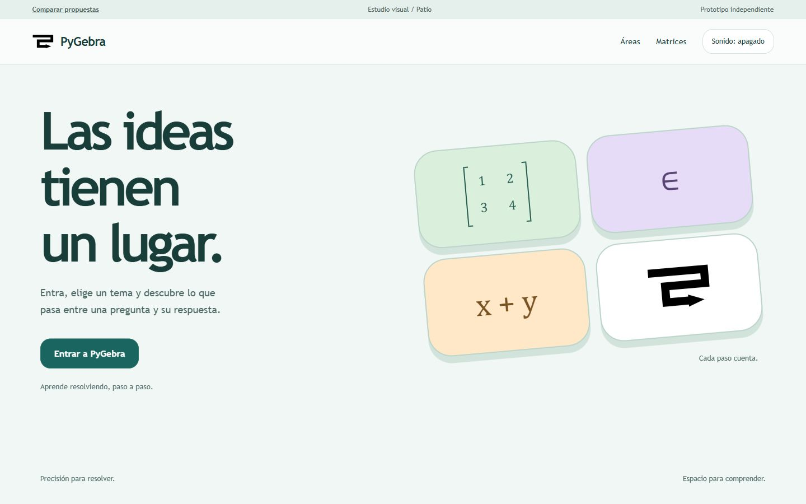
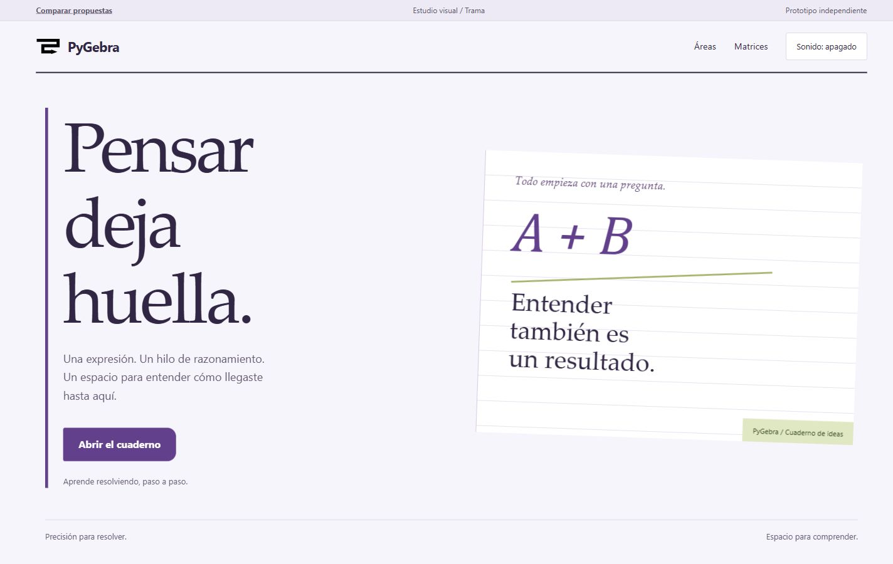
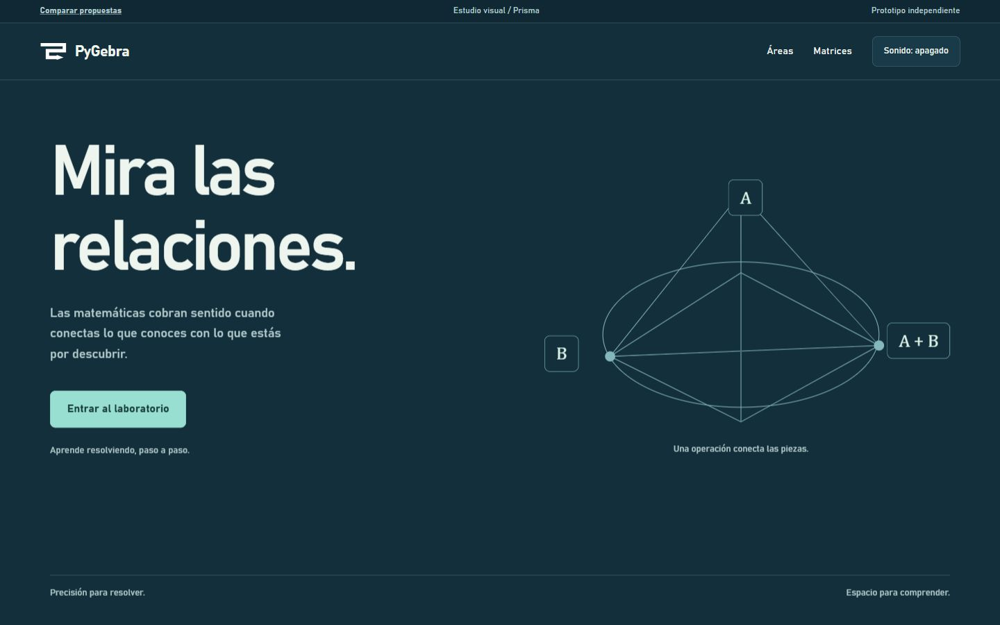

# PyGebra: tres maneras de aprender resolviendo

Exploración del 20 de octubre de 2026. Base: `origin/develop`, commit
`f2c9ef3c6393b5cdade75887c6dda9fa10b74cd0`. Rama:
`feature/exploracion-identidad-visual`. Propuesta para evaluación, sin integración
en el producto ni elección definitiva de identidad.

## Abrir y comparar

Abre [index.html](index.html) con doble clic. Los tres prototipos funcionan con
HTML, CSS y JavaScript locales, sin instalación, compilación, fuentes remotas ni
conexión al backend. El audio requiere una pulsación explícita y soporte Web Audio.
La apertura `file://` se ofrece por su estructura sin `fetch`; la comprobación
automatizada se hizo por HTTP local, no por doble clic.

Para reproducir el entorno probado, ejecuta desde la raíz del repositorio:

```powershell
.venv\Scripts\python.exe -m http.server 8866 --bind 127.0.0.1
```

Abre [el comparador local](http://127.0.0.1:8866/exploraciones/identidad-visual/index.html).
Detén el servidor con Ctrl+C al terminar. Si no tienes el entorno del proyecto,
puedes usar un Python ya instalado con `python -m http.server 8866 --bind 127.0.0.1`.

- **Patio:** [bienvenida](patio.html), [áreas](patio.html#menu), [Matrices](patio.html#herramienta).
- **Trama:** [bienvenida](trama.html), [áreas](trama.html#menu), [Matrices](trama.html#herramienta).
- **Prisma:** [bienvenida](prisma.html), [áreas](prisma.html#menu), [Matrices](prisma.html#herramienta).
- [Prueba automática local](pruebas.html): pulsa **Ejecutar comprobaciones** desde HTTP.

En los tres: entra → busca “matrices” o elige Álgebra lineal → abre Operaciones
con matrices → elige Suma con fracciones → muestra el procedimiento → recorre
las cuatro entradas → compara Exacto y Decimal. También hay una suma entera y
un producto fila por columna. Son **ejemplos precalculados y de solo lectura**;
no se pretende validar edición, errores numéricos ni cálculo arbitrario.

## Comprender el producto actual

### Arquitectura y límites observados

- `frontend/web/calculadora/catalogo.py` concentra áreas, categorías, herramientas,
  estados y relaciones. Alimenta buscador, inicio, migas y navegación. Conviene
  conservarlo como fuente única; las listas del estudio son muestras aisladas.
- `templates/calculadora/base.html` monta marca, cajón de navegación, contenido y
  scripts compartidos. `layouts/herramienta.html` compone título, entrada,
  resultado, explicación y herramientas relacionadas.
- `styles.css` importa tokens → base → shell → componentes → módulos. La base
  actual usa Segoe UI, superficies neutras y el verde `#1A6560`; hay modo oscuro.
  Existe una arquitectura reutilizable, no hace falta reemplazarla para ganar voz.
- Los parciales de matrices, formato numérico, disclosures y teclado contextual
  ya resuelven problemas educativos y de accesibilidad. `entradas.js`, selección,
  copia y deshacer soportan un flujo de captura mucho más rico que este estudio.
- `resultado.js` distingue vigente/desactualizado sin destruir el resultado
  anterior. `presentacion.js` limita el desbordamiento a la matriz correspondiente.
  La identidad futura debe respetar esos contratos.
- `desktop.py` ejecuta Django en loopback con Waitress y lo muestra en pywebview /
  WebView2. Abre maximizado; tamaño nominal 1100 × 760 y mínimo 760 × 560. No hay
  barra de direcciones: volver, orientación y preferencias deben ser explícitos.
  El navegador es privado; las preferencias duraderas pasan por Django. No sería
  correcto confiar en `localStorage` para implantar el sonido en el producto.
- `assets/brand/README.md` define Larga A como símbolo monocromático. Su geometría
  y sus archivos canónicos se conservan; verde es acento de interfaz, no logo verde.
- El directorio `graphify-out/` contiene extracción parcial, sin `graph.json` final.
  El mapa anterior procede de los archivos reales y de ejecución local; no se
  presenta esa extracción incompleta como un grafo de arquitectura validado.

### Diagnóstico de experiencia

1. **El producto se reconoce por su contenido, poco por su forma.** Inicio es
   limpio y comprensible, pero nombre, buscador y listas neutras podrían pertenecer
   a muchas utilidades. El símbolo tiene una geometría aprovechable: recorrido,
   giro y avance. Es una base para un lenguaje propio, no un motivo para sustituirlo.
2. **La entrada por temas es ordenada, aunque exige revelar niveles.** Inicio y
   cajón ofrecen área → categoría → herramienta. El cajón empieza cerrado incluso
   en desktop; esto deja espacio al trabajo, pero oculta la amplitud del producto.
   Las propuestas hacen visible la elección de área y conservan un acceso directo
   a Matrices. El buscador debe seguir siendo un atajo, no la única manera de llegar.
3. **Hay ayudas necesarias que compiten con la acción principal.** En Conjuntos,
   sintaxis literal, vacío, duplicados y restricciones de nombres aparecen antes
   de comprobar una relación; guardar, añadir y comprobar comparten el mismo
   recorrido. En móvil aumenta la distancia entre definir y preguntar. Conviene
   acercar la ayuda a su campo y revelar la gramática avanzada a demanda.
   No eliminar las diferencias entre pertenencia, inclusión e igualdad.
4. **Matrices comunica capacidad, pero comienza con administración.** Nombre,
   tipo y dimensiones de cada operando preceden a la expresión. Esto es útil para
   problemas generales; para empezar con un ejemplo, supone varias decisiones
   antes de experimentar. Explorar ejemplos iniciales editables tras una elección
   futura sería más prometedor que añadir otra capa permanente de instrucciones.
5. **No toda repetición es redundancia.** Descripción de herramienta, explicación
   de operandos y ejemplo de expresión responden a dudas diferentes. Sí merece
   probarse una voz más breve: una instrucción inicial, ayuda junto al control y
   detalle desplegable. Las migas ya evitan repetir área y tema encima del título.
6. **El procedimiento es la ventaja central y puede ganar presencia.** En la
   ejecución de Conjuntos, “Verdadero” queda visible y el procedimiento plegado.
   Es práctico para consultas rápidas; para aprender conviene mostrar al menos
   una explicación significativa y permitir leer todo sin pasar por una animación.
7. **La neutralidad visual protege la precisión.** Espaciado de celdas, números
   exactos, corchetes, scroll local y formatos deben conservar prioridad. Ningún
   concepto debe usar un efecto para insinuar equivalencias matemáticas falsas.
8. **Pantalla pequeña requiere un orden de lectura, no una miniatura del desktop.**
   En Conjuntos a 390 px no se observó desborde horizontal; el formulario sí exige
   desplazamiento vertical considerable. Entrada → procedimiento → resultado es
   el orden de las tres propuestas en móvil. El banco simultáneo de Prisma se
   transforma en una secuencia, con una pérdida deliberada de simultaneidad.

Se inspeccionaron en ejecución Inicio, Operaciones con matrices y Conjuntos
(incluyendo `A ∈ B`, resultado Verdadero), además de templates de Determinantes.
No se auditó cada herramienta ni se entrevistó a estudiantes; son observaciones
de diseño, no mediciones de aprendizaje o productividad.

### Preservar y replantear

**Preservar:** símbolo, nombre, precisión exacta, procedimientos completos,
catálogo central, nombres matemáticos, búsqueda, teclado contextual, navegación
por teclado, modo oscuro, errores asociados a campos, recomendaciones no
bloqueantes, selección/copia/pegado, estado desactualizado y scroll de matrices.

**Replantear:** carácter de bienvenida, visibilidad inicial de las áreas,
jerarquía entre capturar y configurar, distribución de ayudas, relación visual
entre un paso y su entrada de resultado, escalas tipográficas y respuesta a acciones.

## Referencias: cualidades que se trasladan

- **Nintendo Wii:** del brief se toma la hospitalidad, la respuesta rápida y la
  facilidad de reconocer destinos. No se extrajeron canales, Mii, cursores,
  melodías ni recursos originales. No se hizo una auditoría del hardware de Wii.
- [Space Apps Managua](https://www.nasaspaceappsmanagua.com/): se inspeccionó su
  página renderizada. La tipografía protagonista y la composición espacial
  sugieren que un entorno académico puede tener voz. No se reutilizan su paleta,
  marcas, órbitas, fondos, código ni animaciones; Prisma utiliza un diagrama propio
  de operandos, sin estética de misión espacial.
- [Calculadora de OscarDU24](https://github.com/OscarDU24/Algebra-Lineal-): se leyó
  el README público y su descripción de la evolución visual, con dashboard
  expresivo y calculadoras enfocadas en captura y procedimiento. Se toma la
  separación de intensidad entre entrada y trabajo. No se ejecutó esa app ni se
  copiaron imágenes, fuentes, tema negro/rojo o controles.

## Las tres direcciones

### Patio: hospitalidad matemática

**Idea:** PyGebra como lugar de encuentro entre símbolos. El carácter está en los
canales y su tactilidad; las páginas de trabajo se vuelven tranquilas. No es una
consola de juegos ni incorpora puntos, mascotas o recompensas.

**Paleta:** rocío `#F0F7F5`, papel `#FFFFFF`, tinta vegetal `#193D39`, verde PyGebra
`#1A6560`, lavanda `#E6DCF7` y semilla `#FFE8C8`. Los dos últimos distinguen familias,
acompañados siempre por nombres y símbolos. Logo negro.

**Tipografía:** Trebuchet MS en interfaz y títulos, con Segoe UI de respaldo;
Cambria Math en notación. Curvas abiertas y títulos compactos, sin dar a las
expresiones el aspecto de un botón o un texto promocional.

```text
Bienvenida: [ invitación y entrada | canales con símbolos ]
Áreas:      [ álgebra ] [ números ] [ conjuntos ]
Matrices:   [ piezas              | hilo del cálculo      ]
            [ resultado compartido                       ]
```

Textos alineados a la izquierda; símbolos centrados dentro de cada canal. El
hover eleva 3 px el destino seleccionado. La apertura muestra contenido de
inmediato; el desplazamiento de 6 px explica el cambio de pantalla sin bloquearlo.

**Sonido implementado:** senos de 523.25, 659.25 y 783.99 Hz. Navegación usa la
primera nota, paso la segunda, confirmación las dos últimas separadas 55 ms. Es
una señal breve de llegada, sin música continua ni sonido por hover.

**Fortalezas:** conserva el verde y el logo actuales; hace amables los destinos;
buena entrada para estudiantes nuevos; jerarquía espaciosa sin ocultar el resultado.

**Debilidades y riesgos:** los canales consumen espacio y pueden sentirse
infantiles si se exagera el volumen. En teléfonos se convierten en filas, perdiendo
parte del paisaje. Debe comprobarse que estudiantes frecuentes no perciban la
bienvenida como un trámite: acceso directo y bienvenida evitable serían necesarios
si se integrase, después de elegir dirección.



### Trama: pensar deja huella

**Idea:** un cuaderno matemático, con margen y continuidad. El valor no está en
tener muchas herramientas abiertas, sino en poder seguir el argumento. Su
personalidad nace del contraste entre voz tipográfica y notación rigurosa.

**Paleta:** niebla `#F6F5FB`, hoja `#FFFFFF`, tinta ciruela `#312644`, hilo violeta
`#62408C`, anotación `#A1B268` y pestaña `#DFE8C2`. Verde oliva es estructural,
no texto pequeño sobre blanco. Logo negro.

**Tipografía:** Palatino Linotype / Book Antiqua / Palatino para títulos, Segoe UI
para controles y Cambria Math para expresiones. No se descargaron fuentes: la
composición debe revisarse con la familia realmente elegida antes de distribuir.

```text
Bienvenida: [ voz tipográfica     | hoja de razonamiento ]
Áreas:      [ invitación y buscar | índice abierto       ]
Matrices:   [ piezas al margen   | procedimiento         ]
            [                    | resultado             ]
```

El índice es una lista editorial abierta, sin pared de tarjetas. En Matrices,
los operandos son el margen de consulta y el razonamiento ocupa la hoja principal.
El procedimiento completo puede abrirse con un disclosure nativo.

**Sonido implementado:** triángulos de 440, 550 y 660 Hz con envolvente corta.
Las mismas tres funciones usan una familia más seca. No se simula una grabación
de lápiz ni se anuncia como sonido de papel: son tonos sintetizados.

**Fortalezas:** identidad serena y reconocible; lectura larga más natural;
separa configuración y pensamiento; se adapta bien a contenido educativo textual.

**Debilidades y riesgos:** se descubre menos jugando y más leyendo. La tipografía
serif puede sugerir solemnidad o cansar a ciertos lectores. Renglones y anotaciones
no deben interferir con fracciones complejas. Es la opción con mayor riesgo de
variación tipográfica entre sistemas; no tiene un tema oscuro explorado todavía.



### Prisma: ver las relaciones

**Idea:** un laboratorio de estructura. Los símbolos son nodos de un argumento;
las herramientas se ordenan como puntos de partida y las piezas se leen a la vez
que el procedimiento. El espacio no significa tres dimensiones matemáticas: la
ilustración de bienvenida es una metáfora gráfica, no una transformación calculada.

**Paleta:** profundidad `#142F3C`, banco `#193B49`, lectura `#EEF5EF`, señal jade
`#99DFD1`, texto secundario `#B4CCCD` y foco ámbar `#F7D990`. Logo blanco.

**Tipografía:** Bahnschrift / Arial Narrow en títulos; Bahnschrift / Segoe UI en
controles y Cambria Math en notación. Títulos concentrados y números con espacio.

```text
Bienvenida: [ pregunta           | relaciones A, B, A+B ]
Áreas:      [ buscar             | destinos escalonados ]
Matrices:   [ piezas | hilo del cálculo | resultado     ]
```

El mapa conserva enlaces de texto completos: no exige arrastrar, acertar en un
nodo pequeño ni interpretar una constelación para navegar. El banco de tres
columnas pasa a dos y luego una al reducirse la ventana.

**Sonido implementado:** senos de 392, 587.33 y 784 Hz. Intervalos más abiertos,
con el mismo límite de duración. El sonido acompaña la acción, no lleva información
que falte en texto o foco.

**Fortalezas:** hace visible la relación entre datos, operación y respuesta;
personalidad fuerte; simultaneidad útil al estudiar un producto matricial.

**Debilidades y riesgos:** mayor carga visual; menor densidad útil en ventanas
intermedias; el mapa puede escalar mal si aparecen muchas áreas. El oscuro único
no sustituye una exploración de modo claro. No debe sugerir visualizaciones 3D
interactivas ni capacidades que el motor no tiene.



## Decisiones comunes y alcance

- Tres páginas independientes, con una bienvenida, áreas y una herramienta por
  propuesta; cada pantalla tiene enlace directo y vuelve por historial del navegador.
  Hay un controlador compartido solo dentro del estudio para que los mismos
  ejemplos respondan igual y la comparación no dependa de algoritmos distintos.
- La voz visual cambia en composición, tipografía, geometría y jerarquía, además
  del color. Patio usa canales; Trama, índice/margen; Prisma, mapa/banco simultáneo.
- Se descartó una primera posibilidad de tres dashboards de tarjetas equivalentes:
  habría cambiado el aspecto superficial sin poner a prueba una experiencia distinta.
- Se conserva literalmente el path del símbolo oficial. Cambia su contexto, no se
  propone un archivo nuevo de logo ni se regeneran recursos de Windows.
- Sonido apagado al abrir; botón con estado textual y `aria-pressed`, sin guardado
  persistente. Audio de unos 130–185 ms, ganancia digital máxima por voz 0.035.
  Esa cifra no garantiza volumen físico: se necesitan pruebas con auriculares y altavoces.
  Al silenciar se suspende el contexto; al ocultar la página también. Sin sonido automático.
- La navegación no espera los 220 ms de entrada ni los 140 ms del hover. No hay
  timers de navegación, splash obligatorio, scroll suave forzado ni bucles ambientales.
  Se decidió no animar fondos durante lectura: competirían con el procedimiento.
  `prefers-reduced-motion` suprime animaciones y transiciones.
- Nada se importa desde `frontend/`, no hay endpoints de cálculo, instalación de
  paquetes, cambios de versión, releases ni configuración desktop. Única referencia
  externa al directorio del estudio: los recursos de marca locales ya existentes.

## Evaluación y evidencias

Consulta [EVALUACION.md](EVALUACION.md) para los checks, hallazgos pendientes y
límites. Las capturas provienen del navegador de Codex, no de renders generados:

- [Comparador](evidencias/comparador.png).
- Patio: [áreas](evidencias/patio-menu.png), [Matrices](evidencias/patio-matrices.png), [móvil](evidencias/patio-movil.png).
- Trama: [áreas](evidencias/trama-menu.png), [Matrices](evidencias/trama-matrices.png), [móvil](evidencias/trama-movil.png).
- Prisma: [áreas](evidencias/prisma-menu.png), [Matrices](evidencias/prisma-matrices.png), [móvil](evidencias/prisma-movil.png).
- Producción: [entrada matricial](evidencias/actual-matrices.png), [Conjuntos a 390 px](evidencias/actual-conjuntos-movil.png).

## Recomendación y próxima decisión

**Recomiendo Patio como dirección principal para evaluar con estudiantes.** Es la
que mejor conecta la hospitalidad pedida con activos propios de PyGebra: verde,
símbolo de recorrido, áreas claras y precisión en el interior. Puede aportar
personalidad sin exigir una nueva metáfora para comprender una matriz.

Trama merece ser la alternativa finalista si el mayor peso está en sesiones
largas de lectura. Prisma es la hipótesis más expresiva y también la de más riesgo
para primeras visitas y ventanas pequeñas. No recomiendo mezclar los tres estilos
antes de validar qué experiencia reconoce la gente como PyGebra.

No hay evidencia para declarar que una opción enseña mejor. Para decidir, probaría
con 5–6 estudiantes y orden alternado de conceptos, usando las mismas tareas:
encontrar Matrices, explicar cómo se obtiene una entrada, distinguir exacto de
decimal y volver al área. Observar dudas, clics innecesarios, lectura del paso y
preferencia razonada; el gusto visual por sí solo no decide. Añadir una lectura
larga real, edición libre y teclado de pantalla después de elegir finalista.

La decisión solicitada es **qué dirección profundizar**, no aprobar su integración
ni cambiar ahora la identidad de producción.
